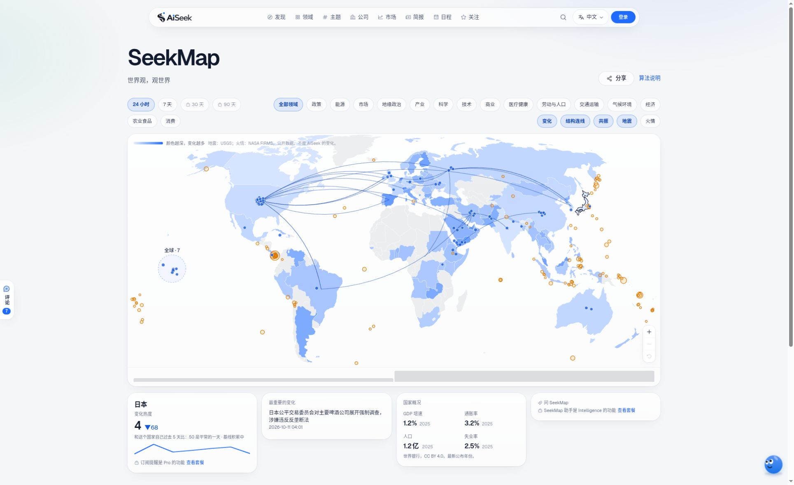
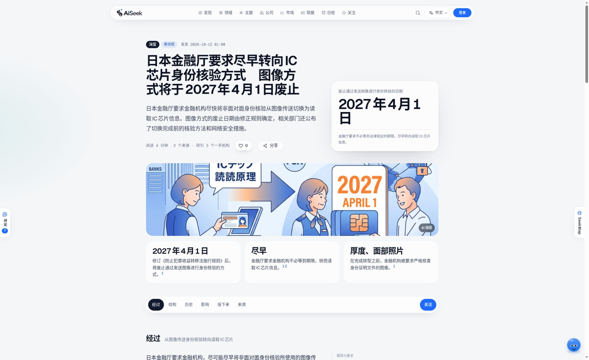
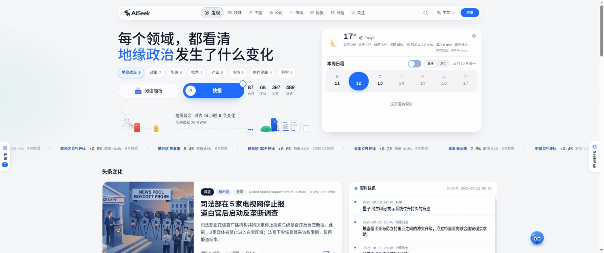
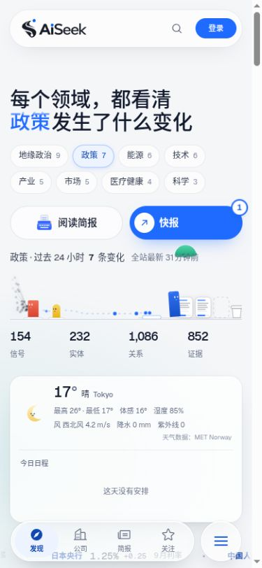
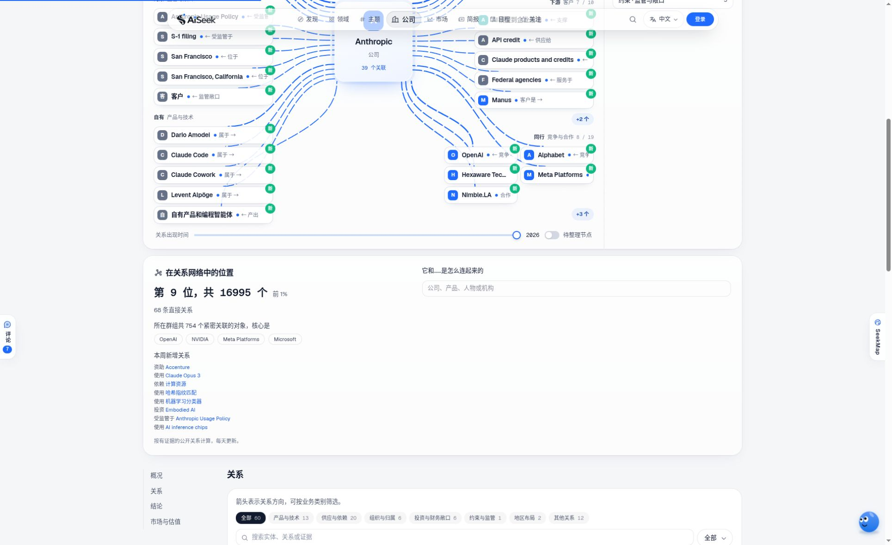

# AiSeek 更新履歴

[English](CHANGELOG.md) · [中文](CHANGELOG.zh-CN.md) · [プロジェクト紹介](README.ja.md) · [AiSeek を開く](https://aiseek.dev/ja)

## 2026-10-12 · P30 から P67 まで

10 月 6 日の紹介版以降の進展をまとめました。変化を世界地図で探す入口、より意味のあるトレンド、中国語・日本語の検索と根拠確認、そして読みやすさと表示速度の改善です。

上の日付は日本時間での紹介資料の編集日で、すべての機能の公開日ではありません。P 番号は開発段階を示します。説明は開発記録と公開サイトに基づきます。新しい画面は 2026-10-12 に撮影し、元の README・画像・コード抜粋は 10 月 6 日の紹介として残しています。未完了・有効化待ちの項目は末尾に分けました。

### 地図から変化をたどる · P45、P54

SeekMap は変化を起きた国に配置し、分野と期間で絞り込み、国境を越える関係を表示します。拡大・縮小、移動、国別詳細に対応。地震・火災などの公開観測データは、AiSeek が捉えた変化とは別に表示します。

P54 では誤解を招く二つの読み取りを修正しました。トレンドは一日全体を比較し、サイト全体の情報量の変化を考慮します。国の変化熱度は、数日分を 30 日分の平均に薄めず、実際に蓄積した日数を使います。50 はその国の平常の一日を表し、履歴が足りない場合は基準を構築中と示します。情報が多い国が常に異常に活発だと見える問題を改善しました。

[SeekMap を開く](https://aiseek.dev/ja/seekmap/jp) · [方法を読む](https://aiseek.dev/ja/method#seekmap)

### 記事を読み、根拠を確かめる · P33–P34、P41、P44

ホームでは詳報を入れ替えながら、経緯、関係、歴史、影響、次の注目点をまとめます。文から出典へ進めるようになり、カードでは出典数と一次情報を区別します。方法説明と訂正履歴も公開しました。取得できなくなった情報源は検出し、対応します。

[画像の記事を読む](https://aiseek.dev/ja/stories/bdbb2942-cfa9-4731-951a-8b7a5c26fe18) · [訂正履歴](https://aiseek.dev/ja/corrections)

### 日常の使い勝手を整える · P31–P32、P35–P43、P46、P49–P50

- 中央銀行の決定や公的統計の発表予定を追加。主要記事、天気、予定、市場情報を日々の閲覧に組み込みました。
- パスキー、メールの認証コード、Microsoft ログインに対応。発見ページのコメントは審査後に公開され、チームが返信できます。
- ダークモード、スマートフォンの詳しい天気と今日の予定、継続的な再描画の削減、前回の訪問以降の変化を追加しました。
- 新規アカウントはフォロー対象を選び、カード不要の 7 日間 Pro 体験を申し込めます。メール購読は初期状態では無効。紹介で追加の体験期間を得られます。現在の内容は料金ページを参照してください。
- 五つのキャラクターとデスクトップの Dot、About、サイト内の更新履歴、アカウント管理も整備しました。

[プラン](https://aiseek.dev/ja/pricing) · [サイトの更新履歴](https://aiseek.dev/ja/changelog)

### ほかのツールでも使える情報へ · P40、P47–P48

読み取り専用 API がすべてのプランで使えるようになりました。MCP に対応した AI ツールは、変化、出典、地図の熱度、予定、ブリーフを取得できます。Developer プラン、メールブリーフ、埋め込み地図・熱度バッジ・カレンダーも追加。日本語 Bluesky を含む公開チャンネルで地図と主要記事を届けます。収集に予備経路を加え、情報源のアクセス規則と公開条件を引き続き守ります。

[開発者向け案内](https://aiseek.dev/ja/developers) · [メールブリーフ](https://aiseek.dev/ja/newsletter)

### 情報源の変化と世界の変化を分ける · P55–P56

根拠確認、エンティティ、場所、検索、トレンドを評価するサンプルと、繰り返し採点する仕組みを整えました。情報源の追加・停止、収集の連続失敗、掲載量の急変がトレンドを動かすことがあります。その影響を取り除くと成立しない動きは「情報源の変化」と表示し、世界で起きた変化として記録しません。候補の検出方法はバックグラウンドで比較しており、現在のルールを置き換えてはいません。

### 三言語を支える理解の改善 · P57–P59、P62

繁体字・簡体字、日本語の漢字、記号や名前の表記違いを、同じ対象として扱いやすくしました。型番が異なる製品は区別し、曖昧な統合案は確認を待ちます。

中国語・日本語の全文検索は表記違いに対応。リサーチの根拠は関連度順に並び、詳報も三言語で検索できます。中国語・日本語の原文から抽出する事実に根拠確認を追加し、Ask の回答も引用した原文と照合します。裏付けのない文は仮説として表示します。ただし、これらの確認であらゆる誤りを検出できるわけではありません。

### 原文を増やし、場所をより正確に · P60–P61

中国語・日本語の情報源を 30 件追加し、現地形式の日付と本文の読み取りを改善しました。日本の上場企業の財務数値は EDINET の原開示から取得し、高度なリサーチでは OpenAlex の学術論文の要旨を使えます。

地図は発生場所、当事者、人物の国籍を区別します。地名と公開知識データを使って都市・地域・施設の所在国を判定。この回のラベル付き場所サンプルでは、ルールの正解率が約 64% から 76% に改善しました。サイト全体の正解率を示す数字ではありません。

### 関係図から関係の分析へ · P63 前半

企業ページに公開関係ネットワークでの位置、所属グループ、今週加わった関係を追加し、二つの対象を結ぶ経路を調べられるようにしました。分析は毎日更新され、根拠のある公開関係を使い、閲覧者が利用できる関係レイヤーを守ります。ネットワーク上の位置は投資評価ではなく、つながりは因果関係の証明ではありません。

[企業ページを開く](https://aiseek.dev/ja/companies/anthropic-company)

### 軽い画像と速いページ移動 · P65–P66

画像を表示に必要な大きさへ縮小し、読者に近い場所でキャッシュします。出典とライセンスは保持します。最近見たページは短期キャッシュを再利用し、クリック前にリンク先のデータを準備。一部のページは主要部分を先に表示してから補足のグラフを追加します。データ節約時は先読みを制限します。公開ページは最新内容から約 2 分遅れる場合があり、更新して確認できます。

### 開発基盤と修正 · P51–P53、P62、この期間の保守

インターネット標準に従って収集規則を読み取ります。開発ツールを更新し、型チェックは TypeScript 7、ツール互換層は TypeScript 6、フロントエンドのビルドは Vite 8 を使用します。モデル処理の滞留を通知し、英語の根拠確認の重み読み込みは以前の結果と照合しました。関係照合では一つの種類の失敗で後続処理を止めなくなり、バックアップの日付判定、公開時のロールバック、接続の再試行も修正しました。

これは新しい閲覧機能とは別の開発記録です。元の README の技術構成は当時の版を説明しています。

### 有効化待ちと今後の予定

| 段階 | 編集時点の状況 |
|---|---|
| P67 · X 投稿 | コードは完成し、責任者によるテスト投稿の確認後に有効化予定。最終形式は画像・リンクなしの文字のみ。内容に応じて日・中・英語を選び、詳報は経緯の全文を使い、長すぎる場合は段落単位で切ります。今回の展示更新では有効化も投稿も行いません。 |
| P63 後半 | 検出方法の長期比較は 60–90 日分の履歴を待ち、2026 年 12 月から予定しています。 |
| P64 | ラベル、対象の統合、名前の読みなど、追加サンプルとデータが必要な作業は P63 後半とともに 12 月を予定しています。 |
| P48 告知開始 | ツール部分は完成。統一した告知開始は責任者の判断待ちです。 |

画像は撮影日の公開画面で、内容や数値は変化します。出典、観測データ、ライセンスは[撮影記録](screenshots/2026-10-12/README.md)と[製品のクレジット](https://aiseek.dev/ja/credits)を参照してください。
