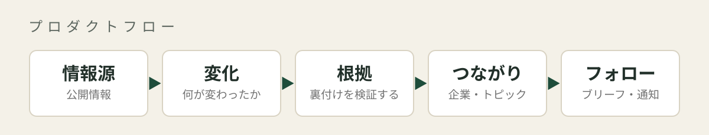
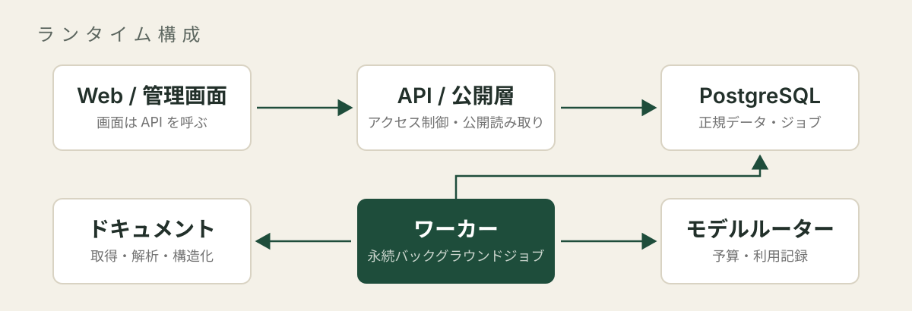

# ゴエンチョウ（WU Yuanchao）

**AiSeek 創設者・フルスタック開発者** — 企画から設計・開発・運用まで、一人で作り続ける Web サービス

[プロダクトを見る](https://aiseek.dev/ja) · [開発者ガイド](https://aiseek.dev/ja/developers) · [設計思想](https://aiseek.dev/ja/method) · [リリース履歴](https://aiseek.dev/ja/changelog)

[English](README.md) · [简体中文](README.zh-CN.md)

---

## ハイライト

本番稼働中の Web サービス [AiSeek](https://aiseek.dev/ja)（日・英・中 3 言語）を一人で企画・設計・開発・運用しています。

| | |
|---|---|
| TypeScript ファイル | 1,316 |
| テストファイル | 342 |
| DB マイグレーション | 102 |
| バックグラウンドジョブ | 61 |
| パッケージ（モノレポ） | 30 |
| アプリ / Python サービス | 4 / 4 |
| 対応ドメイン | 24 |
| CI ワークフロー | ci / deploy / security |

## バッジ

### 稼働状況

[](https://incidents.betterstack.com/?utm_source=status_badge)

本番サービスの稼働状況を公開しています。

### 第三者評価


Product Hunt でフィーチャーされました。

[](https://glama.ai/mcp/connectors/dev.aiseek/ai-seek)

MCP コネクタのツール定義品質とエンドポイント健全性を Glama が第三者評価しています。

[](https://smithery.ai/servers/wyc610721/aiseek)

MCP サーバーディレクトリ Smithery に掲載されています。

### コード品質

[](https://codescene.io/projects/86173) [](https://codescene.io/projects/86173) [](https://codescene.io/projects/86173)

コードヘルスを CodeScene が継続測定しています。

## プロダクト

**AiSeek** — 「See what moved, and why it matters.」

テクノロジー・経済・政策・企業の重要な変化を、根拠と文脈とともに追跡するリサーチプラットフォームです。

- **変化を文脈つきで追う** — 何が変わり、なぜ重要で、どの企業やトピックに触れるかを理解できます。
- **根拠を検証できる** — 主張を FACT（直接裏付けのある事実）/ SUPPORTED（裏付けのある推論）/ HYPOTHESIS（検証が必要な仮説）の 3 種類に分類。SeekTrace が評価・履歴・訂正を記録します。
- **つながりを探索する** — 企業やトピックの関係を構造ビューと SeekMap（地理ビュー）で辿れます。
- **戻ってくる理由** — ウォッチリスト、アラート、日次・週次ブリーフ、リリースカレンダーで関心対象をフォローできます。

## アーキテクチャ



*情報源 → 変化 → 根拠 → つながり → フォロー：公開情報が根拠つきの変化になり、関係分析と継続フォローにつながります。*



*Web / 管理画面は API 経由でのみデータに触れます。公開読み取りは公開層（Publication）が担い、正規データは PostgreSQL に集約。時間のかかる処理は永続ワーカーがバックグラウンドで実行します。*

## 技術的意思決定

非公開リポジトリ `YOLOW92/Aiseek` からの実コード抜粋です。輸入文と周辺のセットアップは省略し、各抜粋が一つの技術判断を示しています。

### 01 · 型で守る API 境界

**課題:** HTTP リクエストの入力はすべて `unknown`。実行時に検証しつつ、TypeScript の型推論は失いたくない。

**判断:** zod で実行時検証し、`z.infer` で戻り値の型を保つ。`parse` は全ルートで使う共通関数。

```typescript
export function parse<T extends z.ZodTypeAny>(schema: T, input: unknown): z.infer<T> {
  const r = schema.safeParse(input);
  if (!r.success) throw new AppError("BAD_REQUEST", r.error.issues.map((i) => `${i.path.join(".")}: ${i.message}`).join("; "));
  return r.data;
}
```

**なぜ:** 契約（スキーマ）は `packages/contracts` に集約し、フロントエンドとバックエンドで共有する。境界での型崩れを根本からなくす。

出典: `apps/api/src/http.ts`

### 02 · 所有権の二重チェック

**課題:** 他人のリサーチ実行を読み取れてはならない。

**判断:** Postgres の RLS（`asUser` コンテキスト）と明示的な所有者チェックの二層で守る。

```typescript
/** Ownership is enforced twice: Postgres RLS (asUser context) and an explicit owner check; non-owners get NOT_FOUND. */
async function loadOwned(pool: Pool, userId: string, runId: string) {
  const run = await withTx(pool, asUser(userId), (tx) => research.getRun(tx, runId));
  if (!run || run.userId !== userId) throw new AppError("NOT_FOUND", "research run");
  return run;
}
```

**なぜ:** 「存在しない」と「権限がない」をどちらも `NOT_FOUND` で返すことで、リソースの存在自体を漏らさない。

出典: `apps/api/src/routes/research/index.ts`

### 03 · トランザクションと RLS コンテキスト

**課題:** 接続プールの使い回しで、ユーザー A の権限がユーザー B のクエリに混ざってはならない。

**判断:** トランザクション開始直後に `set_config` でアクセス文脈を適用し、成功時のみ COMMIT。ROLLBACK 失敗時も元のエラーを保ち、接続は必ず返却する。

```typescript
export type DbContext = { kind: "service" } | { kind: "user"; userId: string } | { kind: "anonymous" };
async function applyContext(client: pg.PoolClient, ctx: DbContext): Promise<void> {
  const userId = ctx.kind === "user" ? ctx.userId : "";
  const role = ctx.kind === "service" ? "service" : "";
  await client.query("SELECT set_config('app.current_user_id', $1, true), set_config('app.role', $2, true)", [userId, role]);
}
export async function withTx<T>(pool: Pool, ctx: DbContext, fn: (tx: Queryable) => Promise<T>): Promise<T> {
  const client = await pool.connect();
  try {
    await client.query("BEGIN");
    await applyContext(client, ctx);
    const result = await fn(client);
    await client.query("COMMIT");
    return result;
  } catch (err) {
    try { await client.query("ROLLBACK"); } catch { /* connection is likely broken; release below discards it */ }
    throw err;
  } finally { client.release(); }
}
```

**なぜ:** 権限は「呼び出し側の注意」ではなく「接続の属性」にする。文脈つきでないクエリを書けなくすることで、権限漏れの余地をなくす。

出典: `packages/database/src/tx.ts`

### 04 · クローラーの SSRF 対策

**課題:** クローラーは外部 URL を取得する。プライベートアドレスやクラウドのメタデータサービスに届いてはならない。

**判断:** IP ブロックリスト、DNS 解決時の検証、レスポンスのバイト予算の三層で防御する。

```typescript
/** Spec 43: crawler fetches must never reach private, loopback, link-local or metadata addresses. */
const blocked = new net.BlockList();
for (const [a, p] of V4) blocked.addSubnet(a, p, "ipv4");   // 10.0.0.0/8, 127.0.0.0/8, 169.254.0.0/16, …
for (const [a, p] of V6) blocked.addSubnet(a, p, "ipv6");
const METADATA_IPS = ["169.254.169.254", "169.254.170.2", "100.100.100.200", "fd00:ec2::254"];
/** DNS lookup that rejects any resolved blocked address: closes the DNS-rebinding window because the connect uses the checked IP. */
function guardedLookup(allowHosts: string[]) { /* 解決した IP を接続前に検証する lookup を返す */ }
for (;;) {
  const { done, value } = await reader.read();
  if (done) break;
  total += value.byteLength;
  if (total > maxBytes) {
    await reader.cancel();
    throw new SsrfError(`Response exceeds ${maxBytes} bytes`);
  }
  chunks.push(value);
}
```

**なぜ:** ブロックは「取得前」に完結させる。DNS リバインディングの窓も、検証済み IP で接続することで閉じる。巨大レスポンスはバッファ前に打ち切る。

出典: `packages/net/src/ssrf.ts`

### 05 · 型付きジョブ投入

**課題:** 61 のバックグラウンドジョブに型のない JSON を投げると、壊れたペイロードがキューに眠る。

**判断:** ペイロードの型をキュー名に束縛し、永続化の前に検証する。

```typescript
/** Typed enqueue: payloads are validated against the contracts schema before they are written (no untyped JSON). */
export class Queue {
  constructor(private readonly boss: PgBoss) {}
  async send<Q extends QueueName>(queue: Q, payload: JobPayload<Q>, opts: EnqueueOptions = {}): Promise<string | null> {
    const envelope = newEnvelope(queue, payload, { actor: opts.actor, correlationId: opts.correlationId });
    parseJob(queue, envelope); // throws on contract violation
    const options: SendOptions = {};
    if (opts.singletonKey) options.singletonKey = opts.singletonKey;
    if (opts.singletonSeconds) options.singletonSeconds = opts.singletonSeconds;
    if (opts.startAfter !== undefined) options.startAfter = opts.startAfter;
    if (opts.priority !== undefined) options.priority = opts.priority;
    return this.boss.send(queue, envelope as unknown as object, options);
  }
}
```

**なぜ:** 契約違反は「書く側」で落とす。キューに積まれた後に気づく失敗をなくし、singleton / 優先度 / 遅延実行を型つきで扱う。

出典: `packages/queue/src/index.ts`

### 06 · 3 言語の全文検索

**課題:** 日本語・中国語・英語を一つの検索で扱いたい。言語ごとに分かち書きの事情が違う。

**判断:** 英語は stemming（`english` 構成）、中日は PGroonga と文字ペアの `simple` 構成を使い分ける。タイトルを要約より重く評価する。

```typescript
await q.query(
  `INSERT INTO search_documents (kind, ref_id, locale, tsv, source_at)
   VALUES ('SIGNAL', $1, $2,
     setweight(to_tsvector('english', $3), 'A') || setweight(to_tsvector('simple', $4), 'A') ||
     setweight(to_tsvector('english', $5), 'B') || setweight(to_tsvector('simple', $6), 'B'),
     $7)
   ON CONFLICT (kind, ref_id, locale) DO UPDATE SET tsv = EXCLUDED.tsv, source_at = EXCLUDED.source_at, indexed_at = now()`,
  [d.refId, d.locale, d.title.latin, d.title.cjk, d.summary.latin, d.summary.cjk, d.sourceAt],
);
// Escaped by PGroonga, so the user's words are never read as query syntax.
string_agg('(' || pgroonga_query_escape(f) || ')', ' OR ')
```

**なぜ:** 言語ごとに最適なエンジンを選ぶ。ユーザー入力は PGroonga のエスケープを通し、クエリ構文として解釈させない。

出典: `packages/database/src/repositories/search.ts`（マイグレーション `0074_pgroonga_search.sql`）

### 07 · 言語を越えたエンティティ同一性

**課題:** 「日本銀行」と「日本银行」、「麒麟 9035」と「麒麟9035」は同じものを指す。表記ゆれでエンティティが分裂してはならない。

**判断:** 繁体字・日本漢字を簡体字に正規化し、空白・句読点を落とし、英語末尾の複数を単数化したキーを作る。

```typescript
export function nameKey(name: string): string {
  const words = normalizeName(simplified(name.normalize("NFKC"))).split(" ");
  return singular(words, name).join("").replace(/[^\p{L}\p{N}]/gu, "");
}
/** "台积电" also finds "臺積電"; "経済産業省" also finds "经济产业省". */
export function scriptVariants(q: string): string[] {
  if (!/\p{Script=Han}/u.test(q)) return [q];
  const simple = simplified(q);
  toTraditional ??= OpenCCTraditional.Converter({ from: "cn", to: "tw" });
  return [...new Set([q, simple, toTraditional(simple)])];
}
```

**なぜ:** 同一性は「完全一致」ではなく「正規化キー」で判定する。ただし型をまたいだ一致は許さず、型番（B200 と H200 など）の混同も防ぐ。回帰テストで保護している。

出典: `packages/entity-engine/src/name-key.ts`

### 08 · 根拠にもとづく主張分類

**課題:** AI の「確信度」で事実を決めてはならない。分類は根拠に従うべき。

**判断:** 決定論的なルールで FACT / SUPPORTED / HYPOTHESIS を分類する。モデルの確信度は入力に使わない。

```typescript
/**
 * Deterministic, evidence-based classification (spec 3.1, 38). Model confidence is never an input.
 *   FACT:       directly stated, >= 1 supporting evidence … with an exact locator …
 *   SUPPORTED:  an inference with >= 2 independent supporting groups …
 *   HYPOTHESIS: everything else (visible as hypothesis, never shown as fact).
 */
export function decideClass(input: PromotionInput): PromotionDecision {
  const supports = input.evidence.filter((e) => e.stance === "SUPPORTS");
  const contradicts = input.evidence.filter((e) => e.stance === "CONTRADICTS");
  const groups = new Set(supports.map((e) => e.independentGroup));
  // …直接言明・独立グループ数・反証の有無で分岐…
  } else if (groups.size >= 2 && input.hasRationale && !contradicted) {
    return { target: "SUPPORTED", reasons, supportingGroups: groups.size, contradicted };
  }
  return { target: "HYPOTHESIS", reasons, supportingGroups: groups.size, contradicted };
}
```

**なぜ:** 分類の根拠（`reasons`）も一緒に記録し、ルール改定時は `PROMOTION_RULE_SET` の版を上げる。いつ・どのルールで判断したかが証跡に残る。

出典: `packages/evidence-engine/src/promote.ts`

### 09 · 改ざん検知できる証跡チェーン

**課題:** 日次の証跡ダイジェストが後から書き換えられていないことを、鍵なしで検証したい。

**判断:** 前日のダイジェストと当日のレシートダイジェストを sha256 で連鎖させる。固定長なので区切り文字も不要。

```typescript
/** A day's digest, given the previous digest and the day's receipt payload digests (in any order; they are sorted here). */
export function dayDigest(prev: Buffer, payloadDigests: Buffer[]): Buffer {
  const h = createHash("sha256").update(prev);
  for (const d of [...payloadDigests].sort(Buffer.compare)) h.update(d);
  return h.digest();
}
```

**なぜ:** 署名も鍵管理もなしに、行の削除・差し替え・順序変更を検出できる。検証は `walkChain` が日付順に歩き、最初に壊れたリンクを返す。

出典: `packages/trace-engine/src/snapshot.ts`（SeekTrace）

### 10 · 公開境界の分離

**課題:** 公開 API から非公開データが一滴も漏れてはならない。

**判断:** 匿名の読み取りは `publication` パッケージ経由に限定し、すべてのクエリが `publications` テーブルに JOIN する。

```typescript
/**
 * Publication boundary (spec 34). Anonymous API/pages read ONLY through this package, and every query here joins the
 * `publications` table (or the canonical FACT/SUPPORTED relation set) so unpublished and private rows are unreachable.
 */
export async function isSignalPublic(db: Queryable, signalId: string): Promise<boolean> {
  const { rows } = await db.query(
    "SELECT 1 FROM publications p JOIN signals s ON s.id = p.ref_id WHERE p.kind = 'SIGNAL' AND p.ref_id = $1 AND p.status = 'PUBLISHED' AND s.public_preview AND s.status <> 'REJECTED'",
    [signalId],
  );
  return rows.length > 0;
}
```

**なぜ:** 公開可否の判定を各所に散らばらせない。境界は一箇所に集め、「公開されていないものはクエリ自体が届かない」構造にする。

出典: `packages/publication/src/scope.ts`

## 技術スタック

- **フロントエンド:** TypeScript · React · React Router · Tailwind CSS
- **バックエンド:** Node.js · Fastify · REST API · pg-boss（バックグラウンドジョブ）
- **データベース:** PostgreSQL（pgvector · PGroonga · Apache AGE）
- **データ処理・リサーチ:** Python（文書解析・情報抽出・グラフ構造による関係管理）
- **インフラ・運用:** Linux · Docker · Docker Compose · Caddy · Cloudflare · GitHub Actions（CI/CD）· VPS

## 運用

個人開発でも「動かし続ける」ことを前提に設計しています。

- **CI:** `ci` / `deploy` / `security` の 3 ワークフロー（GitHub Actions）
- **デプロイ:** Docker Compose + Caddy + Cloudflare（edge-jp 構成）
- **監視:** 稼働ステータスを Better Stack で公開
- **担当範囲:** 企画・要件定義・技術選定・設計・開発・テスト・セキュリティ対策・デプロイ・運用まで一人で担当

## 背景

- 日本電子専門学校 情報処理科に在学中。学校で情報技術の基礎を学ぶ一方、AiSeek を通じて実際のサービス開発に必要な知識と経験を深めています。
- 日本の小売業で勤務し、来客数・売上・時間帯別人員配置などのデータ分析、業務改善案や報告資料の作成に取り組んできました。
- 技術選定の考え方：新しい技術を採用すること自体を目的にせず、機能要件・保守性・セキュリティ・運用コスト・将来の拡張性を考えます。
- 「動くものを作る」ことから、「安心して使い続けられるものを設計する」ことへ。これが AiSeek の開発で得た一番の学びです。

## 連絡先

- [LinkedIn](https://www.linkedin.com/in/yolow92/)
- [GitHub](https://github.com/YOLOW92)
- [Email](mailto:support@aiseek.dev)

日本国内外のエンジニア職に興味があります。お気軽にご連絡ください。

---

*ゴエンチョウ（WU Yuanchao） — AiSeek 創設者・フルスタック開発者*
