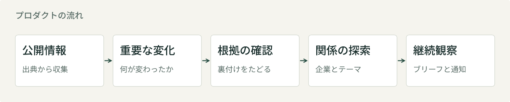
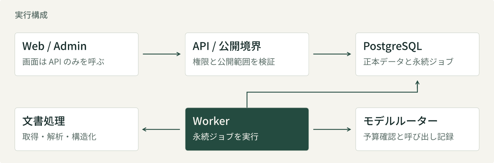

# AiSeek

[English](README.md) · [简体中文](README.zh-CN.md) · **日本語**

技術・経済・政策・企業の重要な変化を追い、出典、背景、次の観察につなぐ情報プラットフォーム。

[製品を使う](https://aiseek.dev/ja) · [開発者ガイド](https://aiseek.dev/ja/developers) · [方法](https://aiseek.dev/ja/method) · [更新履歴](https://aiseek.dev/ja/changelog)

**稼働中の製品 · 三言語 · 読み取り専用 API・MCP**

  

**コード品質 · CodeScene のライブ指標**

  

## 製品の機能

- **変化を理解する。** 何が変わり、なぜ重要で、どの企業やテーマに関わるのかを読む。
- **根拠をたどる。** 出典を確認し、事実・裏付けのある推論・検証待ちの仮説を区別する。SeekTrace が判断の根拠、履歴、訂正を記録する。
- **関係を探索する。** 構造ビューで企業やテーマのつながりを捉え、既存の SeekMap で地理的な背景を確認する。
- **継続して追う。** ウォッチリスト、通知、日次・週次ブリーフ、発表カレンダーで関心のある対象を追う。

## エンジニアリング

- **明確な責務：** 画面は API のみを呼び、各層は共通のデータ契約を使う。公開閲覧は公開境界を通り、非公開リサーチには所有者の確認を設ける。
- **永続性と再構築：** PostgreSQL を正本とし、Apache AGE は再構築可能なグラフ投影とする。キューとワークフローの状態にも PostgreSQL を使う。
- **根拠に基づく規則：** 主張の分類はモデルの自信ではなく根拠で決める。訂正の影響を示して再確認につなぎ、不足する履歴は不明のまま扱う。
- **実行と費用の管理：** 長時間の処理はバックグラウンドで行い、有料モデル呼び出しには予算確認と記録を伴わせる。中日文検索には PGroonga、英語には語形処理を使う。

**技術構成：** TypeScript · React Router · Fastify · Python · PostgreSQL · pgvector · PGroonga · Apache AGE · pg-boss。

## API と MCP

公開済みの変化、出典リンク、企業、発表カレンダー、根拠の履歴を読み取り専用で提供。ツール呼び出しには個人キーを使い、サーバー側で権限と利用枠を確認します。非公開リサーチは公開出力に含めません。

[開発者ガイド](https://aiseek.dev/ja/developers) · [Glama](https://glama.ai/mcp/connectors/dev.aiseek/ai-seek) · [Smithery](https://smithery.ai/servers/wyc610721/aiseek)

## 開発状況

**AiSeek 2.0 は開発中です。** SeekTrace の根拠記録と履歴照会は実装済み。次は SeekEarth を軸に、場所と時間から世界の変化を捉える入口を作ります。SeekEarth は現在利用できる機能としては紹介していません。

## 開発者 WU Yuanchao

AiSeek を発案・主導・運営し、製品の方向性、技術の判断、受け入れ、リリースを担っています。このリポジトリは製品と技術の成果を紹介するもので、アプリケーションのソースは非公開です。

[LinkedIn](https://www.linkedin.com/in/yolow92/) · [GitHub](https://github.com/YOLOW92) · [メール](mailto:support@aiseek.dev) · [AiSeek を支援](https://aiseek.dev/ja/sponsor)

[公開訂正](https://aiseek.dev/ja/corrections) · [オープンソースのクレジット](https://aiseek.dev/ja/credits)
