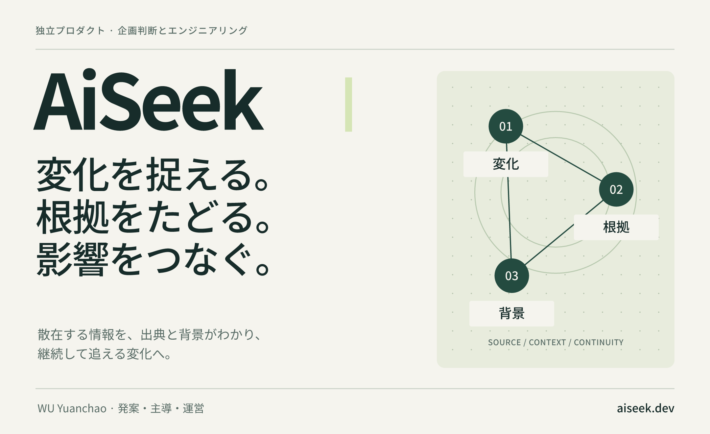
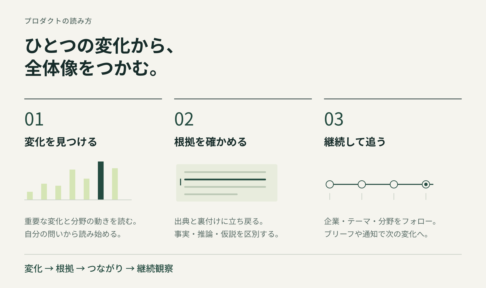
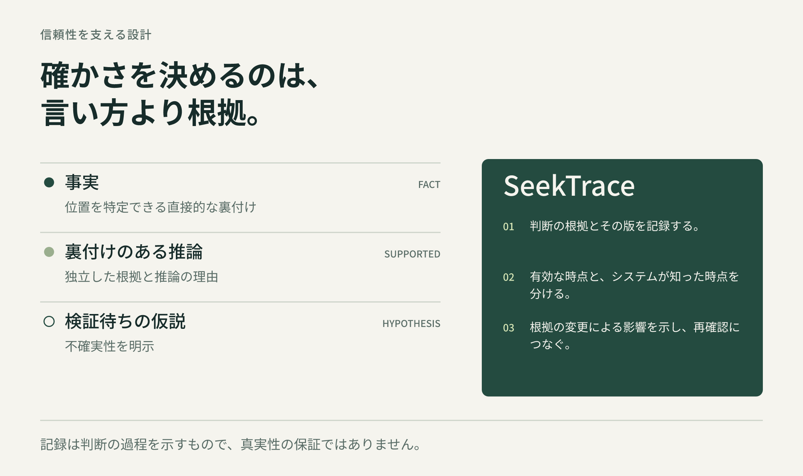
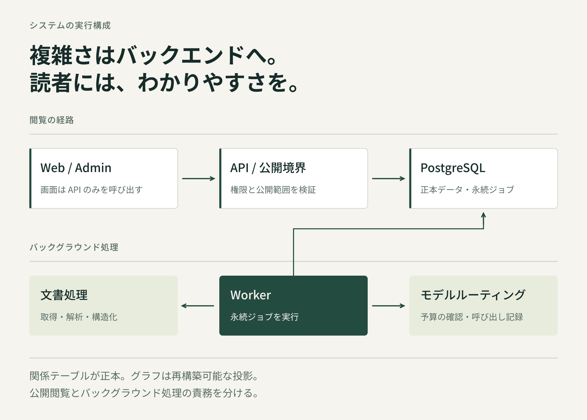
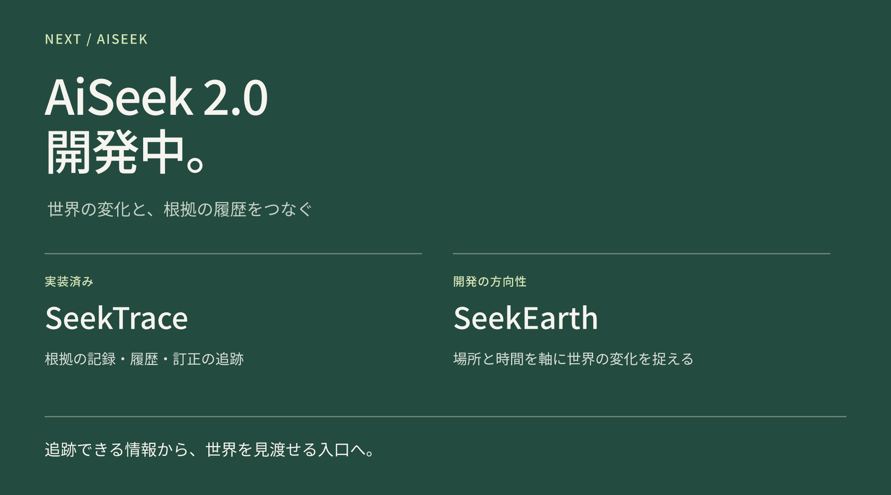

[简体中文](README.zh-CN.md) · **日本語** · [English](README.md)

**稼働中の製品 · 三言語 · 読み取り専用 API・MCP**

  

**コード品質 · CodeScene のライブ指標**

  

# AiSeek｜変化を読み解き、根拠を残す。

重要な変化を捉え、背景を理解し、根拠をたどり、その後も追い続けるための多言語情報プラットフォーム。**WU Yuanchao が発案・主導・運営しています。**

## 情報のひとつを、追う価値のある変化へ

政策の変更、企業の発表、産業の動きは、異なる言語と出典に分散しています。AiSeek は変化を裏付け資料、関係する対象、次の観察点につなぎ、「何が起きたか」から「なぜ注目するのか」まで読み進められるようにします。

変化を開き、出典を確かめる。企業やテーマのページで、種類と根拠が明確な関係をたどる。関心のある対象をフォローし、ブリーフ、通知、発表カレンダーで継続して追う。既存の SeekMap は地理的な入口を、構造ビューは企業やテーマのつながりを提供します。

[AiSeek を使う](https://aiseek.dev/ja) · [方法を読む](https://aiseek.dev/ja/method)

## 事実・推論・仮説を、混ぜない

出典へのリンクだけでは十分ではありません。AiSeek は根拠の位置、直接的な裏付け、情報源の独立性、矛盾を判断に反映します。**事実、裏付けのある推論、検証待ちの仮説**を区別し、モデルの自信の強さで主張の分類を決めません。

**SeekTrace の根拠記録、履歴照会、訂正の追跡は実装済みです。** 判断の根拠を記録し、「いつ有効だったか」と「システムがいつ知ったか」を分けます。根拠が変わると、影響を受ける内容に印を付け、再確認につなぎます。整合性の検証は記録の一貫性を確かめるもので、結論の真実性を保証するものではありません。参照できる履歴は、保存された記録とアカウントの利用範囲に依存します。

[方法と根拠](https://aiseek.dev/ja/method) · [公開訂正](https://aiseek.dev/ja/corrections)

## 体験を支えるエンジニアリングの判断

私は検証できる責務の境界を軸にシステムを組み立てました。画面は API を呼び、公開閲覧は公開境界を通り、長時間の処理は永続キューに入ります。モデル呼び出しには事前の予算確認と記録を伴わせます。共通のデータ契約によって、各層が扱う対象の意味をそろえています。

**正本とグラフを分ける。** PostgreSQL の関係テーブルを正本とし、Apache AGE は再構築可能なグラフ投影を担います。キューとワークフローの状態にも PostgreSQL を使い、運用対象を増やしすぎない構成です。

**検索まで多言語にする。** 中国語・日本語には PGroonga、英語には語形処理を利用します。別名や表記の違いを吸収しながら、意味のある型番の差は保ちます。ログインした利用者が明示的に使う意味検索は、API 内でモデルルーターを経由して処理します。

**信頼性を境界に落とし込む。** 取得の権利と公開表示の権利を別々に確認します。非公開リサーチには所有者と利用権限の検証を設けます。根拠の訂正は影響追跡につなぎ、足りない履歴を現在の状態で埋め合わせません。

**運用までを成果に含める。** リリース検証、戻せるアプリケーションの版、前進のみのデータベース移行、復元演習で継続運用を支えます。テストは構成上の境界、根拠の規則、多言語の同一性、履歴照会を確認します。実際の製品品質は、運用と訂正の記録を通じて検証し続けます。

**技術構成：** TypeScript · React Router · Fastify · Python · PostgreSQL · pgvector · PGroonga · Apache AGE · pg-boss。

## 自分のツールでも、変化を読める

読み取り専用 API と MCP は、公開済みの変化、出典リンク、企業の背景、発表カレンダー、根拠の履歴を外部ツールへ提供します。各ツール呼び出しには個人キーが必要で、サーバー側で権限と利用枠を確認します。出典を保持し、非公開リサーチを公開出力に含めません。

[開発者ガイド](https://aiseek.dev/ja/developers) · [Glama](https://glama.ai/mcp/connectors/dev.aiseek/ai-seek) · [Smithery](https://smithery.ai/servers/wyc610721/aiseek)

## 私が担ったこと

私は製品の位置付け、読む流れ、技術の選択、作業の組み立て、受け入れ判断、リリースを担っています。運用上の問題、根拠の訂正、次の改善方針も扱います。一貫しているのは、読者がまず必要とするのは変化と根拠を理解できること、という判断です。Research はその体験を支え、より深く調べる手段になります。

情報の選別、多言語検索、根拠の連続性、開発者向け接続へと、大きな要件を提供・確認できる単位に分けてきました。AI コーディングツールも実装に参加しています。方向性、制約、レビュー、成果の判断は私が担います。

## 次の段階へ

**AiSeek 2.0 は開発中です。** SeekTrace の根拠基盤は実装済み。次は SeekEarth を軸に、場所、時間、変化、つながりを見渡せる入口を作ります。SeekEarth と今後の投資家向け観察機能は開発の方向性であり、現在利用できる機能としては紹介していません。

## お問い合わせ

プロダクト・エンジニアリングの仕事、製品連携、配信の協業、独立開発への支援について、お気軽にご連絡ください。

[LinkedIn](https://www.linkedin.com/in/yolow92/) · [GitHub](https://github.com/YOLOW92) · [メール](mailto:support@aiseek.dev) · [AiSeek を支援](https://aiseek.dev/ja/sponsor)

図は製品の流れと構成を説明するものです。CodeScene と稼働状況は冒頭の動的バッジで確認できます。[更新履歴](https://aiseek.dev/ja/changelog) · [オープンソースのクレジット](https://aiseek.dev/ja/credits)
