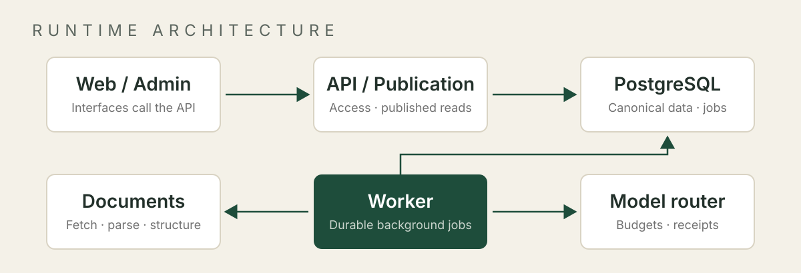

# WU Yuanchao

**Founder of AiSeek · Full-stack developer** — designing, building, and operating a web service solo, from planning to production

[Live product](https://aiseek.dev/en) · [Developer guide](https://aiseek.dev/en/developers) · [Method](https://aiseek.dev/en/method) · [Release history](https://aiseek.dev/en/changelog)

[日本語](README.ja.md) · [简体中文](README.zh-CN.md)

---

## Highlights

I plan, design, develop, and operate [AiSeek](https://aiseek.dev/en), a production web service in three languages (JA/EN/ZH) — on my own.

| | |
|---|---|
| TypeScript files | 1,316 |
| Test files | 342 |
| DB migrations | 102 |
| Background jobs | 61 |
| Packages (monorepo) | 30 |
| Apps / Python services | 4 / 4 |
| Coverage domains | 24 |
| CI workflows | ci / deploy / security |

## Badges

### Live status

[](https://incidents.betterstack.com/?utm_source=status_badge)

The production service's uptime is public.

### Third-party recognition


Featured on Product Hunt.

[](https://glama.ai/mcp/connectors/dev.aiseek/ai-seek)

Glama independently scores the MCP connector's tool definition quality and endpoint health.

[](https://smithery.ai/servers/wyc610721/aiseek)

Listed in the Smithery MCP server directory.

### Code quality

[](https://codescene.io/projects/86173) [](https://codescene.io/projects/86173) [](https://codescene.io/projects/86173)

Code health is continuously measured by CodeScene.

## Product

**AiSeek** — "See what moved, and why it matters."

A research platform that tracks important changes across technology, the economy, policy, and companies — with sources, context, and evidence.

- **Changes with context** — understand what changed, why it matters, and which companies or topics it touches.
- **Evidence you can inspect** — claims are classified as FACT (directly supported) / SUPPORTED (supported inference) / HYPOTHESIS (needs verification). SeekTrace records assessments, history, and corrections.
- **Connected exploration** — follow company and topic relationships through structure views and the SeekMap geographic view.
- **A reason to return** — follow what matters through watchlists, alerts, daily and weekly briefs, and the release calendar.

## Architecture


*Sources → Changes → Evidence → Connections → Follow-up: public information becomes evidenced changes, leading to relationship analysis and ongoing follow-up.*



*Web / Admin touch data only through the API. Public reads go through the Publication layer; canonical data lives in PostgreSQL. Slow work runs in background on a durable worker.*

## Engineering decisions

Real excerpts from the private repository `YOLOW92/Aiseek`. Imports and surrounding setup are omitted; each excerpt demonstrates one engineering decision.

### 01 · Typed API boundaries

**Problem:** Every HTTP request input is `unknown`. I want runtime validation without losing TypeScript's type inference.

**Decision:** Validate with zod at runtime and keep the inferred return type via `z.infer`. One shared `parse` used by every route.

```typescript
export function parse<T extends z.ZodTypeAny>(schema: T, input: unknown): z.infer<T> {
  const r = schema.safeParse(input);
  if (!r.success) throw new AppError("BAD_REQUEST", r.error.issues.map((i) => `${i.path.join(".")}: ${i.message}`).join("; "));
  return r.data;
}
```

**Why:** Contracts (schemas) live in `packages/contracts`, shared by frontend and backend. Type decay at the boundary is eliminated at the root.

Source: `apps/api/src/http.ts`

### 02 · Ownership enforced twice

**Problem:** One user's research runs must never be readable by another.

**Decision:** Two layers — Postgres RLS (`asUser` context) plus an explicit owner check.

```typescript
/** Ownership is enforced twice: Postgres RLS (asUser context) and an explicit owner check; non-owners get NOT_FOUND. */
async function loadOwned(pool: Pool, userId: string, runId: string) {
  const run = await withTx(pool, asUser(userId), (tx) => research.getRun(tx, runId));
  if (!run || run.userId !== userId) throw new AppError("NOT_FOUND", "research run");
  return run;
}
```

**Why:** "Does not exist" and "no permission" both return `NOT_FOUND`, so the very existence of a resource never leaks.

Source: `apps/api/src/routes/research/index.ts`

### 03 · Transactions with an RLS context

**Problem:** Pooled connections are reused — user A's privileges must never bleed into user B's queries.

**Decision:** Apply the access context via `set_config` right after BEGIN, COMMIT only on success, preserve the original error if ROLLBACK also fails, and always release the connection.

```typescript
export type DbContext = { kind: "service" } | { kind: "user"; userId: string } | { kind: "anonymous" };
async function applyContext(client: pg.PoolClient, ctx: DbContext): Promise<void> {
  const userId = ctx.kind === "user" ? ctx.userId : "";
  const role = ctx.kind === "service" ? "service" : "";
  await client.query("SELECT set_config('app.current_user_id', $1, true), set_config('app.role', $2, true)", [userId, role]);
}
export async function withTx<T>(pool: Pool, ctx: DbContext, fn: (tx: Queryable) => Promise<T>): Promise<T> {
  const client = await pool.connect();
  try {
    await client.query("BEGIN");
    await applyContext(client, ctx);
    const result = await fn(client);
    await client.query("COMMIT");
    return result;
  } catch (err) {
    try { await client.query("ROLLBACK"); } catch { /* connection is likely broken; release below discards it */ }
    throw err;
  } finally { client.release(); }
}
```

**Why:** Privilege becomes an attribute of the connection, not a matter of caller discipline. There is no way to write a query without a context, so privilege leaks have no room to happen.

Source: `packages/database/src/tx.ts`

### 04 · SSRF-hardened crawler fetches

**Problem:** The crawler fetches external URLs. It must never reach private addresses or cloud metadata services.

**Decision:** Three layers — an IP blocklist, validation at DNS resolution time, and a byte budget on responses.

```typescript
/** Spec 43: crawler fetches must never reach private, loopback, link-local or metadata addresses. */
const blocked = new net.BlockList();
for (const [a, p] of V4) blocked.addSubnet(a, p, "ipv4");   // 10.0.0.0/8, 127.0.0.0/8, 169.254.0.0/16, …
for (const [a, p] of V6) blocked.addSubnet(a, p, "ipv6");
const METADATA_IPS = ["169.254.169.254", "169.254.170.2", "100.100.100.200", "fd00:ec2::254"];
/** DNS lookup that rejects any resolved blocked address: closes the DNS-rebinding window because the connect uses the checked IP. */
function guardedLookup(allowHosts: string[]) { /* returns a lookup that validates resolved IPs before connecting */ }
for (;;) {
  const { done, value } = await reader.read();
  if (done) break;
  total += value.byteLength;
  if (total > maxBytes) {
    await reader.cancel();
    throw new SsrfError(`Response exceeds ${maxBytes} bytes`);
  }
  chunks.push(value);
}
```

**Why:** Blocking completes *before* the fetch. The DNS-rebinding window is closed by connecting with the validated IP. Oversized responses are cut off before buffering.

Source: `packages/net/src/ssrf.ts`

### 05 · Typed job enqueue

**Problem:** 61 background jobs fed with untyped JSON means broken payloads sleeping in the queue.

**Decision:** Bind payload types to queue names and validate before persistence.

```typescript
/** Typed enqueue: payloads are validated against the contracts schema before they are written (no untyped JSON). */
export class Queue {
  constructor(private readonly boss: PgBoss) {}
  async send<Q extends QueueName>(queue: Q, payload: JobPayload<Q>, opts: EnqueueOptions = {}): Promise<string | null> {
    const envelope = newEnvelope(queue, payload, { actor: opts.actor, correlationId: opts.correlationId });
    parseJob(queue, envelope); // throws on contract violation
    const options: SendOptions = {};
    if (opts.singletonKey) options.singletonKey = opts.singletonKey;
    if (opts.singletonSeconds) options.singletonSeconds = opts.singletonSeconds;
    if (opts.startAfter !== undefined) options.startAfter = opts.startAfter;
    if (opts.priority !== undefined) options.priority = opts.priority;
    return this.boss.send(queue, envelope as unknown as object, options);
  }
}
```

**Why:** Contract violations fail at the writer, not hours later in the queue. Singleton, priority, and delayed execution stay typed.

Source: `packages/queue/src/index.ts`

### 06 · Trilingual full-text search

**Problem:** Search across Japanese, Chinese, and English in one query — each language tokenizes differently.

**Decision:** English uses stemming (`english` config); Chinese/Japanese use PGroonga with character-pair `simple` config. Titles weigh more than summaries.

```typescript
await q.query(
  `INSERT INTO search_documents (kind, ref_id, locale, tsv, source_at)
   VALUES ('SIGNAL', $1, $2,
     setweight(to_tsvector('english', $3), 'A') || setweight(to_tsvector('simple', $4), 'A') ||
     setweight(to_tsvector('english', $5), 'B') || setweight(to_tsvector('simple', $6), 'B'),
     $7)
   ON CONFLICT (kind, ref_id, locale) DO UPDATE SET tsv = EXCLUDED.tsv, source_at = EXCLUDED.source_at, indexed_at = now()`,
  [d.refId, d.locale, d.title.latin, d.title.cjk, d.summary.latin, d.summary.cjk, d.sourceAt],
);
// Escaped by PGroonga, so the user's words are never read as query syntax.
string_agg('(' || pgroonga_query_escape(f) || ')', ' OR ')
```

**Why:** Pick the best engine per language. User input goes through PGroonga escaping so it is never interpreted as query syntax.

Source: `packages/database/src/repositories/search.ts` (migration `0074_pgroonga_search.sql`)

### 07 · Entity identity across scripts

**Problem:** "日本銀行" and "日本银行", "麒麟 9035" and "麒麟9035" are the same thing. Spelling variants must not split entities.

**Decision:** Fold traditional/Japanese kanji to simplified, drop spaces and punctuation, singularize trailing English plurals — then compare keys.

```typescript
export function nameKey(name: string): string {
  const words = normalizeName(simplified(name.normalize("NFKC"))).split(" ");
  return singular(words, name).join("").replace(/[^\p{L}\p{N}]/gu, "");
}
/** "台积电" also finds "臺積電"; "経済産業省" also finds "经济产业省". */
export function scriptVariants(q: string): string[] {
  if (!/\p{Script=Han}/u.test(q)) return [q];
  const simple = simplified(q);
  toTraditional ??= OpenCCTraditional.Converter({ from: "cn", to: "tw" });
  return [...new Set([q, simple, toTraditional(simple)])];
}
```

**Why:** Identity is decided by a normalized key, not exact match. Keys never cross entity types, and model codes ("B200" vs "H200") are guarded separately. Protected by regression tests.

Source: `packages/entity-engine/src/name-key.ts`

### 08 · Evidence-based claim classification

**Problem:** An AI's "confidence" must never decide what counts as fact. Classification must follow evidence.

**Decision:** A deterministic rule set classifies FACT / SUPPORTED / HYPOTHESIS. Model confidence is never an input.

```typescript
/**
 * Deterministic, evidence-based classification (spec 3.1, 38). Model confidence is never an input.
 *   FACT:       directly stated, >= 1 supporting evidence … with an exact locator …
 *   SUPPORTED:  an inference with >= 2 independent supporting groups …
 *   HYPOTHESIS: everything else (visible as hypothesis, never shown as fact).
 */
export function decideClass(input: PromotionInput): PromotionDecision {
  const supports = input.evidence.filter((e) => e.stance === "SUPPORTS");
  const contradicts = input.evidence.filter((e) => e.stance === "CONTRADICTS");
  const groups = new Set(supports.map((e) => e.independentGroup));
  // …branches on direct statement, independent group count, contradiction…
  } else if (groups.size >= 2 && input.hasRationale && !contradicted) {
    return { target: "SUPPORTED", reasons, supportingGroups: groups.size, contradicted };
  }
  return { target: "HYPOTHESIS", reasons, supportingGroups: groups.size, contradicted };
}
```

**Why:** The reasons are recorded alongside the decision, and the rule-set version (`PROMOTION_RULE_SET`) is bumped on any change — so every receipt says when and under which rules it was judged.

Source: `packages/evidence-engine/src/promote.ts`

### 09 · A tamper-evident evidence chain

**Problem:** Prove that daily evidence digests were not rewritten afterwards — without keys.

**Decision:** Chain each day's digest from the previous day's digest plus that day's receipt digests with sha256. Fixed-width parts need no separator.

```typescript
/** A day's digest, given the previous digest and the day's receipt payload digests (in any order; they are sorted here). */
export function dayDigest(prev: Buffer, payloadDigests: Buffer[]): Buffer {
  const h = createHash("sha256").update(prev);
  for (const d of [...payloadDigests].sort(Buffer.compare)) h.update(d);
  return h.digest();
}
```

**Why:** No signatures, no key management — yet deleted, swapped, or reordered rows are detectable. `walkChain` walks the days in order and returns the first broken link.

Source: `packages/trace-engine/src/snapshot.ts` (SeekTrace)

### 10 · A separated publication boundary

**Problem:** Not a single drop of private data may leak through the public API.

**Decision:** Anonymous reads go ONLY through the `publication` package, and every query there JOINs the `publications` table.

```typescript
/**
 * Publication boundary (spec 34). Anonymous API/pages read ONLY through this package, and every query here joins the
 * `publications` table (or the canonical FACT/SUPPORTED relation set) so unpublished and private rows are unreachable.
 */
export async function isSignalPublic(db: Queryable, signalId: string): Promise<boolean> {
  const { rows } = await db.query(
    "SELECT 1 FROM publications p JOIN signals s ON s.id = p.ref_id WHERE p.kind = 'SIGNAL' AND p.ref_id = $1 AND p.status = 'PUBLISHED' AND s.public_preview AND s.status <> 'REJECTED'",
    [signalId],
  );
  return rows.length > 0;
}
```

**Why:** Publication checks are not scattered across call sites. The boundary lives in one place, structured so that unpublished rows are unreachable by construction.

Source: `packages/publication/src/scope.ts`

## Stack

- **Frontend:** TypeScript · React · React Router · Tailwind CSS
- **Backend:** Node.js · Fastify · REST API · pg-boss (background jobs)
- **Database:** PostgreSQL (pgvector · PGroonga · Apache AGE)
- **Data processing & research:** Python (document parsing, extraction, graph-based relation management)
- **Infra & ops:** Linux · Docker · Docker Compose · Caddy · Cloudflare · GitHub Actions (CI/CD) · VPS

## Operations

Built to keep running, even as a solo project.

- **CI:** three workflows — `ci` / `deploy` / `security` (GitHub Actions)
- **Deploy:** Docker Compose + Caddy + Cloudflare (edge-jp setup)
- **Monitoring:** public status page via Better Stack
- **Scope:** planning, requirements, tech selection, design, development, testing, security, deploy, and ops — all solo

## Background

- Studying Information Processing at Japan Electronics College (日本電子専門学校 情報処理科). Alongside school fundamentals, I deepen real service-development skills through AiSeek.
- Work in Japanese retail: analyzing visitor counts, sales, and time-slot staffing data; writing business-improvement proposals and reports.
- On tech selection: never adopt new technology for its own sake — weigh requirements, maintainability, security, ops cost, and future extensibility.
- From "building things that work" to "designing things you can keep using with confidence" — the biggest lesson from building AiSeek.

## Contact

- [LinkedIn](https://www.linkedin.com/in/yolow92/)
- [GitHub](https://github.com/YOLOW92)
- [Email](mailto:support@aiseek.dev)

I'm interested in engineering roles in Japan and globally. Feel free to reach out.

---

*WU Yuanchao — Founder of AiSeek · Full-stack developer*
