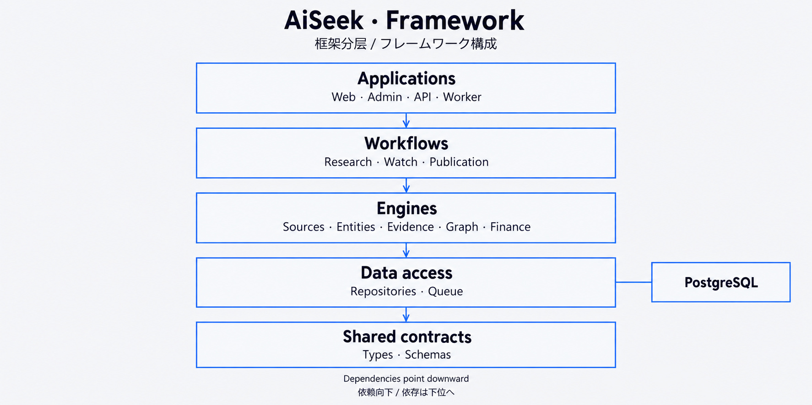

# WU Yuanchao
### Independent developer · Product builder

[English](README.md) · [简体中文](README.zh-CN.md) · [日本語](README.ja.md)

**I turn a product idea into a working system—and stay responsible for what it publishes.**

[Explore AiSeek](https://aiseek.dev/en) · [LinkedIn](https://www.linkedin.com/in/yolow92/) · [GitHub](https://github.com/YOLOW92) · [Get in touch](https://aiseek.dev/en/contact)

*Concept artwork, generated for this portfolio. It is not a product screenshot or a diagram of the implementation.*

## Selected work / AiSeek

**A multilingual information platform for understanding what changed, why it matters, and where the evidence comes from.**

AiSeek brings important changes, their context and their sources into one reading experience. Readers can explore connections, follow subjects and return through alerts and briefs. The main product is available in English, Chinese and Japanese.

I initiated the project and own its product direction, requirements, engineering constraints, acceptance decisions and operation. This portfolio focuses on the main information platform.

## Three things this work demonstrates

| Capability | My decision | Evidence to examine |
|---|---|---|
| **Product judgment** | Put changes and their significance before raw article volume; let readers reach the supporting material. | [Product case](docs/CASES.md#01--make-information-useful), [method](https://aiseek.dev/en/method), [release notes](https://aiseek.dev/en/changelog) |
| **System boundaries** | Keep public reading, private work and external calls behind explicit contracts and server checks. | [Engineering case](docs/CASES.md#02--make-boundaries-enforceable), [selected code](proof/README.md) |
| **Delivery ownership** | Treat multilingual reading, corrections, discovery and ongoing operation as part of the product. | [Delivery case](docs/CASES.md#03--own-the-product-after-release), [live product](https://aiseek.dev/en), [status](https://status.aiseek.dev) |

## System at a glance

[Framework, runtime and stack](docs/ARCHITECTURE.md) — how public reading, background work and stored state fit together.

## Try the work

Start with a change on [AiSeek](https://aiseek.dev/en), then inspect its supporting sources. Explore the connections, follow a subject, or read a brief. For integrations, see the [developer guide](https://aiseek.dev/en/developers).

| Reader need | Delivered product surface |
|---|---|
| Understand a change | Changes, contextual dossiers and source passages |
| See connections and places | Structure views and the existing SeekMap |
| Come back with a purpose | Follows, alerts, briefs and release calendars |
| Connect another tool | Read-only API and MCP, with account limits |

These are capabilities documented in the product's release history, checked against the source revision recorded in the [evidence notes](proof/README.md). They are not claims of measured accuracy, traction or revenue. Availability and current terms belong to the live product.

## Next / AiSeek 2.0

*Future-direction concept art. The capabilities below are planned, not delivered.*

**SeekEarth:** a more coherent view of a changing world, bringing geography and time into the flagship experience.

**SeekTrace:** clearer evidence records and history, helping readers distinguish what was known then from what is known now.

The direction is set; implementation remains planned as of **15 October 2026**. This section deliberately stops at the product ambition.

## Let's build something worthwhile

**Hiring:** I am interested in roles where product judgment and hands-on delivery belong together. [Connect on LinkedIn](https://www.linkedin.com/in/yolow92/) or [contact me](https://aiseek.dev/en/contact).

**Support and collaboration:** individual sponsorship, infrastructure or data-access support, product partnerships and investment conversations are welcome. [Support AiSeek](https://aiseek.dev/en/sponsor) · [GitHub Sponsors](https://github.com/sponsors/YOLOW92) · [Ko-fi](https://ko-fi.com/aiseek).

**Try and share:** [aiseek.dev](https://aiseek.dev/en). Public contact: [support@aiseek.dev](mailto:support@aiseek.dev).

---

Development uses AI-assisted coding tools. Product direction, constraints, review, acceptance and operation are my responsibility. This is a selected portfolio, not a release of the private application. [Evidence and limitations](proof/README.md) · [Attribution and reuse](THIRD_PARTY_NOTICES.md) · Reviewed **2026-10-15**.
