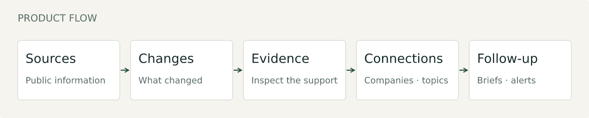
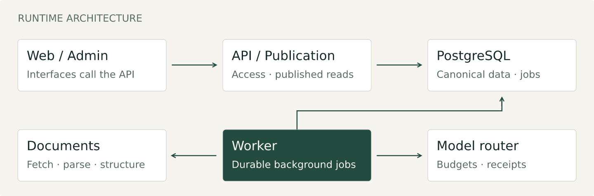

# AiSeek

**English** · [简体中文](README.zh-CN.md) · [日本語](README.ja.md)

Track important changes across technology, the economy, policy and companies, with sources, context and a way to follow up.

[Live product](https://aiseek.dev/en) · [Developer guide](https://aiseek.dev/en/developers) · [Method](https://aiseek.dev/en/method) · [Release history](https://aiseek.dev/en/changelog)

<a href="https://www.producthunt.com/products/aiseek?embed=true&amp;utm_source=badge-featured&amp;utm_medium=badge&amp;utm_campaign=badge-aiseek" target="_blank" rel="noopener noreferrer"></a>

**Live product · Three languages · Read-only API & MCP**

[](https://glama.ai/mcp/connectors/dev.aiseek/ai-seek) [](https://smithery.ai/servers/wyc610721/aiseek) [](https://incidents.betterstack.com/?utm_source=status_badge)

**Code quality · Live CodeScene metrics**

[](https://codescene.io/projects/86173) [](https://codescene.io/projects/86173) [](https://codescene.io/projects/86173)

## Product

- **Changes with context.** Understand what changed, why it matters and which companies or topics it touches.
- **Evidence you can inspect.** Trace supporting sources; distinguish facts, supported inferences and open hypotheses. SeekTrace records assessments, historical states and corrections.
- **Connected exploration.** Explore company and topic relationships through structure views and the existing geographic SeekMap.
- **A reason to return.** Follow subjects through watchlists, alerts, daily and weekly briefs, and the release calendar.



## Engineering



- **Clear boundaries:** API-facing interfaces, shared data contracts, a publication layer for public reads, and ownership checks for private research.
- **Durable data:** PostgreSQL is canonical; Apache AGE is a rebuildable graph projection. PostgreSQL also backs job queues and workflow state.
- **Evidence rules:** claim classification follows evidence, not model confidence. Corrections flag affected work for review; unavailable history remains unknown.
- **Controlled execution:** long tasks run in the background; paid model requests use budgets and provider receipts. Chinese and Japanese retrieval use PGroonga alongside English stemming.

**Stack:** TypeScript · React Router · Fastify · Python · PostgreSQL · pgvector · PGroonga · Apache AGE · pg-boss.

## Implementation highlights

Selected production and test excerpts. Imports and surrounding setup are omitted; each excerpt demonstrates a specific engineering decision.

**01 · Typed API boundaries**

Validate unknown input at runtime while preserving the inferred TypeScript return type.

```typescript
export function parse<T extends z.ZodTypeAny>(
  schema: T, input: unknown
): z.infer<T> {
  const r = schema.safeParse(input);
  if (!r.success) throw new AppError(
    "BAD_REQUEST",
    r.error.issues
      .map((i) => `${i.path.join(".")}: ${i.message}`)
      .join("; ")
  );
  return r.data;
}
```

**02 · Ownership enforced in two layers**

Read under the user’s database context and check ownership explicitly. Missing and inaccessible runs both return NOT_FOUND.

```typescript
async function loadOwned(pool: Pool, userId: string, runId: string) {
  const run = await withTx(
    pool, asUser(userId), (tx) => research.getRun(tx, runId)
  );
  if (!run || run.userId !== userId)
    throw new AppError("NOT_FOUND", "research run");
  return run;
}
```

**03 · Transaction lifecycle and cleanup**

Apply the access context inside the transaction, commit only after success, and preserve the original error if rollback also fails. Always release the connection.

```typescript
export async function withTx<T>(
  pool: Pool, ctx: DbContext,
  fn: (tx: Queryable) => Promise<T>
): Promise<T> {
  const client = await pool.connect();
  try {
    await client.query("BEGIN");
    await applyContext(client, ctx);
    const result = await fn(client);
    await client.query("COMMIT");
    return result;
  } catch (err) {
    try {
      await client.query("ROLLBACK");
    } catch {
    }
    throw err;
  } finally {
    client.release();
  }
}
```

**04 · Typed background dispatch**

Tie payload types to queue names, validate the envelope before persistence, and pass optional singleton, scheduling and priority controls to the durable queue.

```typescript
export class Queue {
  constructor(private readonly boss: PgBoss) {}

  async send<Q extends QueueName>(
    queue: Q, payload: JobPayload<Q>,
    opts: EnqueueOptions = {}
  ): Promise<string | null> {
    const envelope = newEnvelope(queue, payload, {
      actor: opts.actor, correlationId: opts.correlationId
    });
    parseJob(queue, envelope); // throws on contract violation
    const options: SendOptions = {};
    if (opts.singletonKey) options.singletonKey = opts.singletonKey;
    if (opts.singletonSeconds) options.singletonSeconds = opts.singletonSeconds;
    if (opts.startAfter !== undefined) options.startAfter = opts.startAfter;
    if (opts.priority !== undefined) options.priority = opts.priority;
    return this.boss.send(queue, envelope as unknown as object, options);
  }
}
```

**05 · Bounded network reads**

Cancel a response once it exceeds the byte budget, before buffering the entire body.

```typescript
for (;;) {
  const { done, value } = await reader.read();
  if (done) break;
  total += value.byteLength;
  if (total > maxBytes) {
    await reader.cancel();
    throw new SsrfError(`Response exceeds ${maxBytes} bytes`);
  }
  chunks.push(value);
}
```

**06 · Graceful degradation without hiding client errors**

Let public loaders recover from backend failures while keeping most client errors visible. Rate limiting is handled as a recoverable case.

```typescript
export async function safe<T>(p: Promise<T>, fallback: T): Promise<T> {
  try {
    return await p;
  } catch (e) {
    if (
      e instanceof ApiFailure &&
      e.status >= 400 && e.status < 500 && e.status !== 429
    ) throw e;
    return fallback;
  }
}
```

**07 · Multilingual identity regression tests**

Protect a shared entity identity across Chinese and Japanese writing variants.

```typescript
it("folds traditional Chinese and Japanese kanji to simplified", () => {
  expect(nameKey("日本銀行")).toBe(nameKey("日本银行"));
  expect(nameKey("臺積電")).toBe(nameKey("台积电"));
  expect(nameKey("経済産業省")).toBe(nameKey("经济产业省"));
  expect(nameKey("台風27号")).toBe(nameKey("台风27号"));
});
```

**08 · Historical precision regression test**

Before recorded history begins, return existence only and no inferred past state. The test prevents today’s claim class from leaking into historical answers.

```typescript
const r = at(A, rows, d("10-10"), d("09-20"));
expect(r).toMatchObject({
  precision: "EXISTENCE_ONLY", existed: true,
  state: null, evidence: null, knownSince: baseline
});
expect(JSON.stringify(r)).not.toMatch(/FACT|HYPOTHESIS/);
```

## API & MCP

Read-only access to published changes, source links, companies, release calendars and evidence history. Tool calls use personal API keys with server-enforced permissions and quotas; private research stays outside public output.

[Developer guide](https://aiseek.dev/en/developers) · [Glama](https://glama.ai/mcp/connectors/dev.aiseek/ai-seek) · [Smithery](https://smithery.ai/servers/wyc610721/aiseek)

## In development

**AiSeek 2.0 is in development.** SeekTrace evidence records and historical queries are implemented. SeekEarth is the next direction: organising world changes by place and time. SeekEarth is not presented as an available feature.

## Built by WU Yuanchao

I initiated, lead and operate AiSeek, owning product direction, technical decisions, acceptance and releases. Selected code excerpts are public for review; the full application remains private.

[LinkedIn](https://www.linkedin.com/in/yolow92/) · [GitHub](https://github.com/YOLOW92) · [Email](mailto:support@aiseek.dev) · [Support AiSeek](https://aiseek.dev/en/sponsor)

<sub>[Corrections](https://aiseek.dev/en/corrections) · [Open-source credits](https://aiseek.dev/en/credits)</sub>
