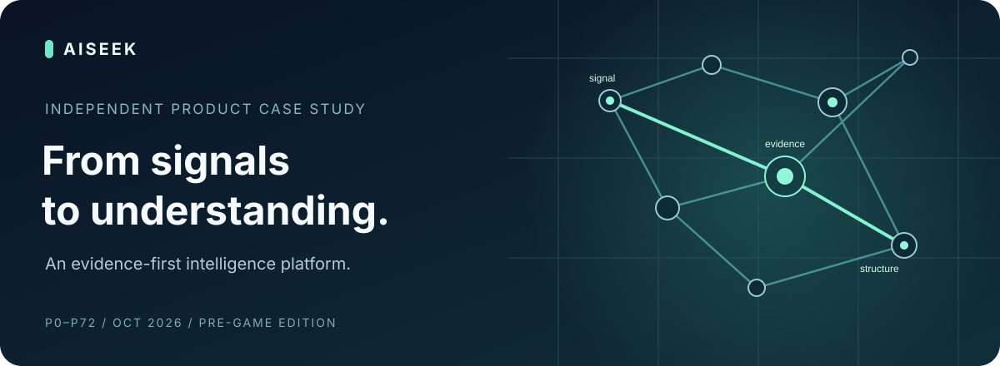

# AiSeek

**From signals to understanding.**

An independently directed, AI-assisted product built for evidence-first change intelligence.

[**Explore the live product ↗**](https://aiseek.dev/en) · [**Engineering case studies ↗**](docs/engineering/CASES.md) · [**Work / collaborate ↗**](docs/connect/README.md)

**English** · [简体中文](README.zh-CN.md) · [日本語](README.ja.md)

> **Portfolio edition · P0–P72 · 2–12 October 2026 · Pre-game scope.** This is a public **showcase**, not the product's source repository. All artwork is original explanatory SVG; no live-site screenshots or fabricated dashboards.

## What I built

AiSeek organizes changes found in public information across **24 subject areas** — from technology and markets to policy and science — into an inspectable chain of **signals, evidence, entities and relationships**.

It asks more than *“What's new?”*: **What changed, why might it matter, what is connected, and what does the evidence actually support?**

| Discover | Investigate | Follow & integrate |
|:--|:--|:--|
| Signals, daily brief, deep reads, multilingual search | Source passages, claim grades, company structures, SeekMap, guided research | Following, notifications, calendars, read-only API and MCP |

**Live in Chinese · English · Japanese.** The product's exact current features may differ from this dated case study. [Product walkthrough →](docs/product/README.md)

## Two paths through this portfolio

| **For hiring managers & engineering leads** | **For potential partners & investors** |
|:--|:--|
| Understand my product decisions, AI-agent collaboration, engineering constraints, operations and real trade-offs. | Understand the user problem, product thesis, differentiation, commercial paths, traction caveats and open questions. |
| [**Creator's role & timeline →**](docs/journey/README.md) | [**Opportunity & business model →**](docs/business/README.md) |
| [**Engineering architecture →**](docs/engineering/README.md) | [**Proof & limitations →**](docs/proof/README.md) |

## Engineering choices worth examining

1. **Evidence cannot be promoted by a model's confidence.** Facts, supported inferences and hypotheses have explicit, source-based conditions. [Case study](docs/engineering/CASES.md#01--deciding-what-may-be-called-a-fact) · [real code](proof/code/promote.ts).
2. **Relationships cannot be invented as arbitrary labels.** A typed, controlled vocabulary establishes what may connect and how its provenance is retained. [Case study](docs/engineering/CASES.md#02--making-a-relationship-graph-explainable) · [real code](proof/code/relation-registry.ts).
3. **Chinese and Japanese are first-class search problems**, requiring indexing, identity normalization and multilingual support checks — not just translated copy. [Case study](docs/engineering/CASES.md#03--finding-one-entity-across-languages).
4. **A spike in publisher activity is not automatically a real-world trend.** Source-change flags and complete-day baselines matter. [Case study](docs/engineering/CASES.md#04--distinguishing-news-volume-from-an-actual-change).
5. **Resource limits are design constraints.** Async jobs, model budgets, bounded compute, production recovery and page-performance measures are part of the product. [Case study](docs/engineering/CASES.md#05--shipping-on-constrained-infrastructure) · [real code](proof/code/gate.py).

## The person behind the work

**WU Yuanchao · [YOLOW92](https://github.com/YOLOW92)**

I initiated, directed and operated AiSeek as an independent, self-funded project, using **Claude Code and Codex as substantial coding collaborators**. My contribution centers on product direction, task decomposition, constraints, review, integration, troubleshooting and delivery. **This is not a claim that I personally hand-coded the entire private codebase.**

[Read the project journey →](docs/journey/README.md)

## What is verifiable — and what is still unproven

| Demonstrated in the P72 portfolio | Not claimed here |
|:--|:--|
| Public multilingual product, source-linked reading, graph and map workflows | Independently audited factual accuracy |
| Original public source excerpts for key design rules | Full open source or reproducible standalone deployment |
| Dated development records and operational trade-offs | Verified active-user growth, revenue or profitability |
| Subscription and developer interface foundations | Proven product-market fit or a completed funding round |

**Historical context, not audience traction:** the original 6 October showcase recorded 740 signals, 13,337 entities, 5,654 relations and 64,473 evidence items. These are dated, self-reported *content inventory* figures, **not** current P72 figures, customers or revenue. [Exact status and evidence levels →](docs/proof/README.md)

### Talk to me

I welcome conversations about **technical product and engineering roles**, AI-native building, research or data partnerships, product pilots, sponsorship and investment exploration.

**[Contact WU Yuanchao →](docs/connect/README.md)** · [LinkedIn](https://www.linkedin.com/in/%E3%82%A8%E3%83%B3%E3%83%81%E3%83%A7%E3%82%A6-%E3%82%B4-6ab2a2413/) · [support@aiseek.dev](mailto:support@aiseek.dev)

---

**Scope & rights.** This edition intentionally excludes all game development and AiSeek 2.0. The original production repository is private. The three published code excerpts are retained from the previous showcase unchanged; other text and original illustrations © 2026 YOLOW92, all rights reserved. Product third-party acknowledgements: [Credits](https://aiseek.dev/en/credits). This portfolio is informational, not a financial offer or investment advice.
