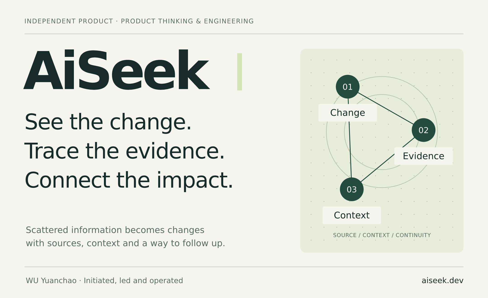
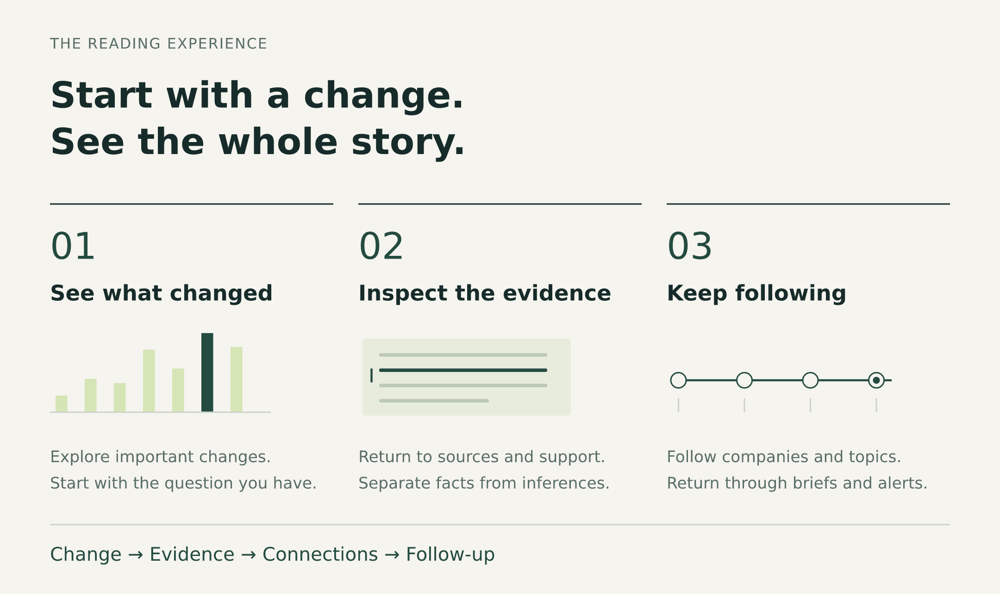
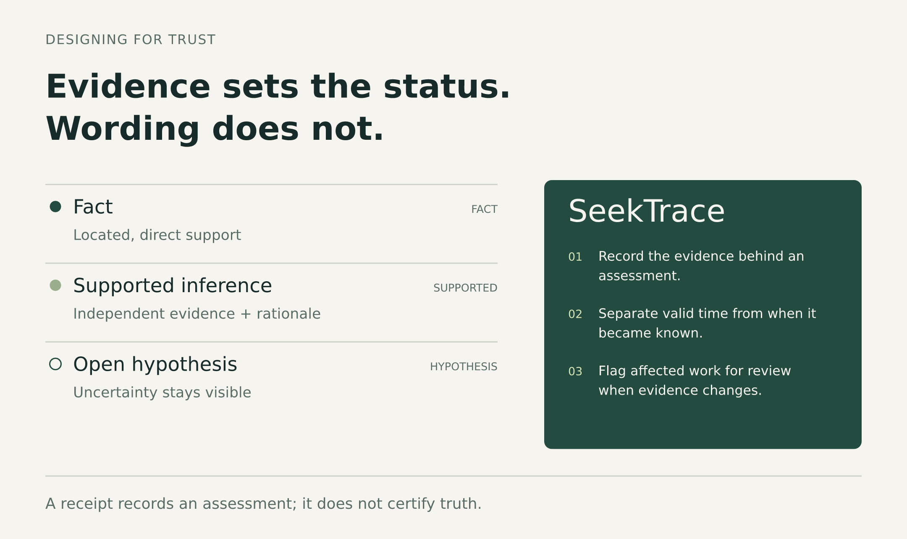
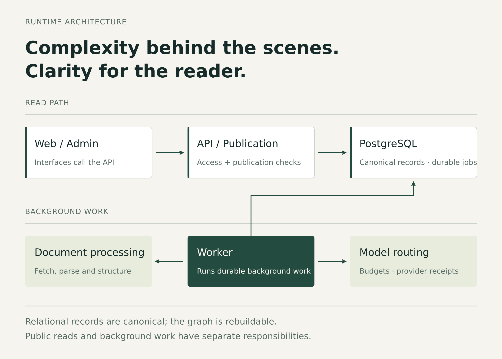
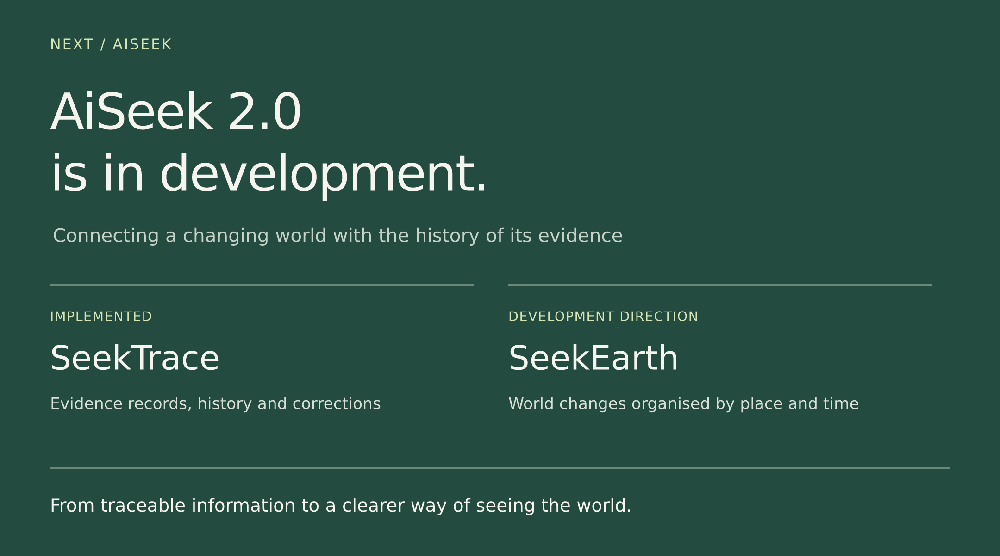

[简体中文](README.zh-CN.md) · [日本語](README.ja.md) · **English**

**Live product · Three languages · Read-only API & MCP**

  

**Code quality · Live CodeScene metrics**

  

# AiSeek | Understand the change. Keep the evidence.

A multilingual information platform for seeing important changes, understanding their context, tracing evidence and following what happens next. **Initiated, led and operated by WU Yuanchao.**

## From another item in a feed to a change worth following

A policy decision, a company announcement or an industry shift often arrives across disconnected sources and languages. AiSeek connects the change with supporting material, affected subjects and what to watch next, so a reader can move from “what happened” to “why it deserves attention”.

Open a change and inspect its sources. Explore a company or topic through typed, evidence-backed relationships. Follow subjects through briefs, alerts and the release calendar. The existing SeekMap provides geographic context; structure views reveal connections between companies and topics.

[Try AiSeek](https://aiseek.dev/en) · [Read the method](https://aiseek.dev/en/method)

## Facts, inferences and hypotheses each have their place

A source link is only the beginning. AiSeek considers exact locations, direct support, independent evidence and contradictions. **Facts, supported inferences and open hypotheses** remain distinct. A model's confidence cannot decide a claim's class.

**SeekTrace evidence records, historical queries and correction tracking are implemented.** It records the basis of an assessment, separates when a claim holds from when the system knew it, and flags affected work for review when evidence changes. Integrity checks establish consistency of records, not the truth of a conclusion. Available history depends on retained records and account entitlements.

[Method and evidence](https://aiseek.dev/en/method) · [Public corrections](https://aiseek.dev/en/corrections)

## Engineering decisions behind the experience

I organised the system around responsibilities that can be checked: interfaces call the API, public reads pass through publication checks, long tasks enter a durable queue, and model requests reserve budget and leave receipts. Shared data contracts connect the layers so modules agree on the objects they exchange.

**Separate canonical data from the graph.** PostgreSQL relational tables hold the canonical records. Apache AGE is a rebuildable graph projection. Queues and workflow state reuse PostgreSQL, keeping the operational surface manageable.

**Make language part of retrieval.** PGroonga supports Chinese and Japanese search, alongside English stemming. Aliases and script variants help find the same entity while meaningful model-number differences remain distinct. User-triggered semantic search runs in the API for signed-in users through the model router.

**Make trust a system boundary.** Crawl rights and public display rights are checked separately. Private research has ownership and server-side entitlement checks. Corrections trigger impact tracking; missing history stays unknown rather than being reconstructed from today's state.

**Treat operation as part of delivery.** Release checks, recoverable application versions, forward-only database migrations and restore exercises support continued operation. Tests cover architectural boundaries, evidence rules, multilingual identity and historical queries. They check the rules; operation and correction records continue to test the product in practice.

**Technology:** TypeScript · React Router · Fastify · Python · PostgreSQL · pgvector · PGroonga · Apache AGE · pg-boss.

## Bring the changes into your own tools

The read-only API and MCP expose published changes, source links, company context, the release calendar and evidence history. Every tool call uses a personal key with server-enforced access and quotas. Responses retain their sources; private research stays outside public output.

[Developer guide](https://aiseek.dev/en/developers) · [Glama](https://glama.ai/mcp/connectors/dev.aiseek/ai-seek) · [Smithery](https://smithery.ai/servers/wyc610721/aiseek)

## My part in making it a product

I own product positioning, reading flows, technical tradeoffs, work organisation, acceptance and release decisions. I also handle production issues, evidence corrections and the direction of each iteration. One judgment runs throughout: readers first need a clear view of the change and its evidence. Research supports that experience and offers a path into deeper investigation.

From information selection and multilingual retrieval to evidence continuity and developer access, I turn broad requirements into work that can be delivered and inspected. AI coding tools participate in implementation; I own direction, constraints, review and delivery decisions.

## What comes next

**AiSeek 2.0 is in development.** The SeekTrace evidence foundation is implemented. The next direction is SeekEarth: a more coherent way to explore places, time, changes and connections. SeekEarth and further investor observation features are development work, not presented as currently available capabilities.

## Get in touch

I welcome conversations about product and engineering roles, integrations, distribution partnerships and support for independent development.

[LinkedIn](https://www.linkedin.com/in/yolow92/) · [GitHub](https://github.com/YOLOW92) · [Email](mailto:support@aiseek.dev) · [Support AiSeek](https://aiseek.dev/en/sponsor)

Visuals explain product flows and architecture. Live CodeScene and service status appear in the badges above. [Release history](https://aiseek.dev/en/changelog) · [Open-source credits](https://aiseek.dev/en/credits)
