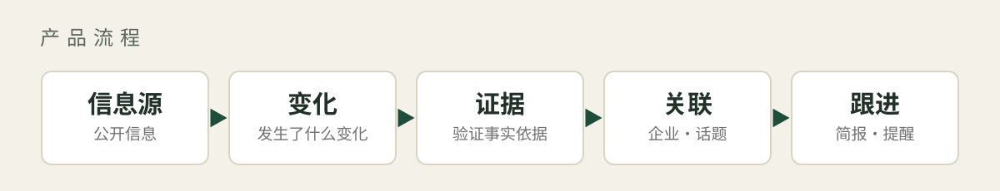
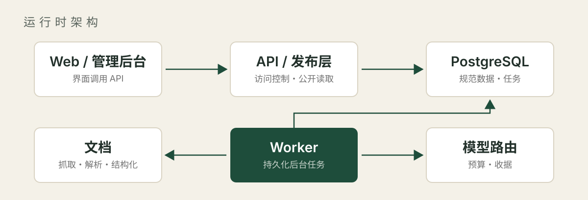

# 吴袁超（WU Yuanchao）

**AiSeek 创始人・全栈开发者** — 从策划到设计、开发、运维，一人持续构建的 Web 服务

[在线产品](https://aiseek.dev/zh) · [开发者指南](https://aiseek.dev/zh/developers) · [设计思想](https://aiseek.dev/zh/method) · [发布记录](https://aiseek.dev/zh/changelog)

[日本語](README.ja.md) · [English](README.md)

---

## 亮点

一人策划、设计、开发并运维着生产级 Web 服务 [AiSeek](https://aiseek.dev/zh)（日・英・中三语）。

| | |
|---|---|
| TypeScript 文件 | 1,316 |
| 测试文件 | 342 |
| DB 迁移 | 102 |
| 后台任务 | 61 |
| 包（monorepo） | 30 |
| 应用 / Python 服务 | 4 / 4 |
| 覆盖领域 | 24 |
| CI 流水线 | ci / deploy / security |

## 徽章

### 运行状态

[](https://incidents.betterstack.com/?utm_source=status_badge)

生产服务的运行状态对外公开。

### 第三方认可

[](https://www.producthunt.com/products/aiseek?embed=true&utm_source=badge-featured&utm_medium=badge&utm_campaign=badge-aiseek)

曾被 Product Hunt 推荐。

[](https://glama.ai/mcp/connectors/dev.aiseek/ai-seek)

Glama 对 MCP 连接器的工具定义质量与端点健康度做第三方评分。

[](https://smithery.ai/servers/wyc610721/aiseek)

已收录于 MCP 服务器目录 Smithery。

### 代码质量

[](https://codescene.io/projects/86173) [](https://codescene.io/projects/86173) [](https://codescene.io/projects/86173)

代码健康度由 CodeScene 持续度量。

## 产品

**AiSeek** — "See what moved, and why it matters."

追踪科技、经济、政策、企业的重要变化，附带来源、上下文与证据的研究平台。

- **带着上下文追踪变化** — 理解发生了什么、为什么重要、触及哪些企业与话题。
- **证据可查验** — 主张分为 FACT（有直接依据的事实）/ SUPPORTED（有依据的推论）/ HYPOTHESIS（待验证的假设）三类。SeekTrace 记录评估、历史状态与更正。
- **探索关联** — 通过结构视图与 SeekMap（地理视图）追溯企业与话题的关系。
- **让人回来的理由** — 关注列表、提醒、日 / 周简报、发布日历，持续跟进关心的对象。

## 架构



*信息源 → 变化 → 证据 → 关联 → 跟进：公开信息变成有证据的变化，进而形成关系分析与持续跟进。*



*Web / 管理后台只能经由 API 接触数据。公开读取走发布层（Publication），规范数据汇聚于 PostgreSQL。耗时处理由持久化 Worker 在后台执行。*

## 技术决策

以下代码摘自非公开仓库 `YOLOW92/Aiseek` 的真实代码。省略 import 与周边 setup，每段展示一个技术决策。

### 01 · 用类型守住 API 边界

**问题：** HTTP 请求的输入全是 `unknown`。既要运行时校验，又不想丢掉 TypeScript 的类型推断。

**决策：** 用 zod 做运行时校验，用 `z.infer` 保留返回类型。全路由共用一个 `parse`。

```typescript
export function parse<T extends z.ZodTypeAny>(schema: T, input: unknown): z.infer<T> {
  const r = schema.safeParse(input);
  if (!r.success) throw new AppError("BAD_REQUEST", r.error.issues.map((i) => `${i.path.join(".")}: ${i.message}`).join("; "));
  return r.data;
}
```

**为什么：** 契约（schema）集中在 `packages/contracts`，前后端共享。从根上消灭边界处的类型塌陷。

出处：`apps/api/src/http.ts`

### 02 · 所有权的双重检查

**问题：** 绝不能让用户 A 读到用户 B 的研究任务。

**决策：** Postgres RLS（`asUser` 上下文）+ 显式所有者检查，双层防护。

```typescript
/** Ownership is enforced twice: Postgres RLS (asUser context) and an explicit owner check; non-owners get NOT_FOUND. */
async function loadOwned(pool: Pool, userId: string, runId: string) {
  const run = await withTx(pool, asUser(userId), (tx) => research.getRun(tx, runId));
  if (!run || run.userId !== userId) throw new AppError("NOT_FOUND", "research run");
  return run;
}
```

**为什么：** "不存在"与"无权限"都返回 `NOT_FOUND`，连资源的存在性都不泄露。

出处：`apps/api/src/routes/research/index.ts`

### 03 · 带 RLS 上下文的事务

**问题：** 连接池会被复用——用户 A 的权限绝不能混进用户 B 的查询。

**决策：** BEGIN 之后立即用 `set_config` 应用访问上下文，成功才 COMMIT；ROLLBACK 失败也保留原始错误，连接必定归还。

```typescript
export type DbContext = { kind: "service" } | { kind: "user"; userId: string } | { kind: "anonymous" };
async function applyContext(client: pg.PoolClient, ctx: DbContext): Promise<void> {
  const userId = ctx.kind === "user" ? ctx.userId : "";
  const role = ctx.kind === "service" ? "service" : "";
  await client.query("SELECT set_config('app.current_user_id', $1, true), set_config('app.role', $2, true)", [userId, role]);
}
export async function withTx<T>(pool: Pool, ctx: DbContext, fn: (tx: Queryable) => Promise<T>): Promise<T> {
  const client = await pool.connect();
  try {
    await client.query("BEGIN");
    await applyContext(client, ctx);
    const result = await fn(client);
    await client.query("COMMIT");
    return result;
  } catch (err) {
    try { await client.query("ROLLBACK"); } catch { /* connection is likely broken; release below discards it */ }
    throw err;
  } finally { client.release(); }
}
```

**为什么：** 把权限做成"连接的属性"，而不是"调用者的自觉"。写不出不带上下文的查询，权限泄露就没有发生的余地。

出处：`packages/database/src/tx.ts`

### 04 · 爬虫的 SSRF 防护

**问题：** 爬虫要抓外部 URL，绝不能打到内网地址或云元数据服务。

**决策：** IP 黑名单 + DNS 解析时验证 + 响应字节预算，三层防御。

```typescript
/** Spec 43: crawler fetches must never reach private, loopback, link-local or metadata addresses. */
const blocked = new net.BlockList();
for (const [a, p] of V4) blocked.addSubnet(a, p, "ipv4");   // 10.0.0.0/8, 127.0.0.0/8, 169.254.0.0/16, …
for (const [a, p] of V6) blocked.addSubnet(a, p, "ipv6");
const METADATA_IPS = ["169.254.169.254", "169.254.170.2", "100.100.100.200", "fd00:ec2::254"];
/** DNS lookup that rejects any resolved blocked address: closes the DNS-rebinding window because the connect uses the checked IP. */
function guardedLookup(allowHosts: string[]) { /* 返回在连接前验证解析 IP 的 lookup */ }
for (;;) {
  const { done, value } = await reader.read();
  if (done) break;
  total += value.byteLength;
  if (total > maxBytes) {
    await reader.cancel();
    throw new SsrfError(`Response exceeds ${maxBytes} bytes`);
  }
  chunks.push(value);
}
```

**为什么：** 拦截在"抓取之前"完成。用验证过的 IP 建连，堵住 DNS 重绑定窗口。超大响应在缓冲之前就掐断。

出处：`packages/net/src/ssrf.ts`

### 05 · 类型化的任务投递

**问题：** 61 个后台任务如果投的是无类型 JSON，坏掉的 payload 会在队列里睡觉。

**决策：** payload 类型绑定队列名，持久化之前先校验。

```typescript
/** Typed enqueue: payloads are validated against the contracts schema before they are written (no untyped JSON). */
export class Queue {
  constructor(private readonly boss: PgBoss) {}
  async send<Q extends QueueName>(queue: Q, payload: JobPayload<Q>, opts: EnqueueOptions = {}): Promise<string | null> {
    const envelope = newEnvelope(queue, payload, { actor: opts.actor, correlationId: opts.correlationId });
    parseJob(queue, envelope); // throws on contract violation
    const options: SendOptions = {};
    if (opts.singletonKey) options.singletonKey = opts.singletonKey;
    if (opts.singletonSeconds) options.singletonSeconds = opts.singletonSeconds;
    if (opts.startAfter !== undefined) options.startAfter = opts.startAfter;
    if (opts.priority !== undefined) options.priority = opts.priority;
    return this.boss.send(queue, envelope as unknown as object, options);
  }
}
```

**为什么：** 契约破坏在"写入方"就失败，不会几小时后才在队列里爆炸。单例、优先级、延迟执行都有类型。

出处：`packages/queue/src/index.ts`

### 06 · 三语全文检索

**问题：** 一次查询要覆盖日、中、英——每种语言的分词情况都不一样。

**决策：** 英文用 stemming（`english` 配置），中日用 PGroonga + 字符对的 `simple` 配置。标题权重高于摘要。

```typescript
await q.query(
  `INSERT INTO search_documents (kind, ref_id, locale, tsv, source_at)
   VALUES ('SIGNAL', $1, $2,
     setweight(to_tsvector('english', $3), 'A') || setweight(to_tsvector('simple', $4), 'A') ||
     setweight(to_tsvector('english', $5), 'B') || setweight(to_tsvector('simple', $6), 'B'),
     $7)
   ON CONFLICT (kind, ref_id, locale) DO UPDATE SET tsv = EXCLUDED.tsv, source_at = EXCLUDED.source_at, indexed_at = now()`,
  [d.refId, d.locale, d.title.latin, d.title.cjk, d.summary.latin, d.summary.cjk, d.sourceAt],
);
// Escaped by PGroonga, so the user's words are never read as query syntax.
string_agg('(' || pgroonga_query_escape(f) || ')', ' OR ')
```

**为什么：** 每种语言选最合适的引擎。用户输入经 PGroonga 转义，永远不会被当成查询语法解析。

出处：`packages/database/src/repositories/search.ts`（迁移 `0074_pgroonga_search.sql`）

### 07 · 跨文字的实体同一性

**问题：** "日本銀行"和"日本银行"、"麒麟 9035"和"麒麟9035"是同一个东西。表记差异不能把实体拆散。

**决策：** 繁体字・日文汉字归一到简体，去掉空格标点，英文尾词复数变单数，再比较 key。

```typescript
export function nameKey(name: string): string {
  const words = normalizeName(simplified(name.normalize("NFKC"))).split(" ");
  return singular(words, name).join("").replace(/[^\p{L}\p{N}]/gu, "");
}
/** "台积电" also finds "臺積電"; "経済産業省" also finds "经济产业省". */
export function scriptVariants(q: string): string[] {
  if (!/\p{Script=Han}/u.test(q)) return [q];
  const simple = simplified(q);
  toTraditional ??= OpenCCTraditional.Converter({ from: "cn", to: "tw" });
  return [...new Set([q, simple, toTraditional(simple)])];
}
```

**为什么：** 同一性用"归一化 key"判定，而不是精确匹配。key 不跨实体类型，型号（B200 vs H200）另有防护。有回归测试守护。

出处：`packages/entity-engine/src/name-key.ts`

### 08 · 基于证据的主张分级

**问题：** 不能用 AI 的"置信度"来决定什么是事实。分级必须跟随证据。

**决策：** 用确定性规则集做 FACT / SUPPORTED / HYPOTHESIS 分级。模型置信度永不作为输入。

```typescript
/**
 * Deterministic, evidence-based classification (spec 3.1, 38). Model confidence is never an input.
 *   FACT:       directly stated, >= 1 supporting evidence … with an exact locator …
 *   SUPPORTED:  an inference with >= 2 independent supporting groups …
 *   HYPOTHESIS: everything else (visible as hypothesis, never shown as fact).
 */
export function decideClass(input: PromotionInput): PromotionDecision {
  const supports = input.evidence.filter((e) => e.stance === "SUPPORTS");
  const contradicts = input.evidence.filter((e) => e.stance === "CONTRADICTS");
  const groups = new Set(supports.map((e) => e.independentGroup));
  // …按直接陈述・独立分组数・有无反证分支…
  } else if (groups.size >= 2 && input.hasRationale && !contradicted) {
    return { target: "SUPPORTED", reasons, supportingGroups: groups.size, contradicted };
  }
  return { target: "HYPOTHESIS", reasons, supportingGroups: groups.size, contradicted };
}
```

**为什么：** 判定的理由（`reasons`）一并记录；规则变更时 bump `PROMOTION_RULE_SET` 版本号。每条收据都写明何时、按哪版规则判定。

出处：`packages/evidence-engine/src/promote.ts`

### 09 · 可验改的证据链

**问题：** 想在无密钥的前提下，验证每日证据摘要事后没被改写。

**决策：** 用前一天的摘要 + 当天的收据摘要做 sha256 链。定长分段，不需要分隔符。

```typescript
/** A day's digest, given the previous digest and the day's receipt payload digests (in any order; they are sorted here). */
export function dayDigest(prev: Buffer, payloadDigests: Buffer[]): Buffer {
  const h = createHash("sha256").update(prev);
  for (const d of [...payloadDigests].sort(Buffer.compare)) h.update(d);
  return h.digest();
}
```

**为什么：** 无签名、无密钥管理，照样能发现删除、替换、乱序。`walkChain` 按天顺序走一遍，返回第一个断裂的环节。

出处：`packages/trace-engine/src/snapshot.ts`（SeekTrace）

### 10 · 发布边界的隔离

**问题：** 公开 API 里一滴非公开数据都不能漏。

**决策：** 匿名读取只走 `publication` 包，所有查询都 JOIN `publications` 表。

```typescript
/**
 * Publication boundary (spec 34). Anonymous API/pages read ONLY through this package, and every query here joins the
 * `publications` table (or the canonical FACT/SUPPORTED relation set) so unpublished and private rows are unreachable.
 */
export async function isSignalPublic(db: Queryable, signalId: string): Promise<boolean> {
  const { rows } = await db.query(
    "SELECT 1 FROM publications p JOIN signals s ON s.id = p.ref_id WHERE p.kind = 'SIGNAL' AND p.ref_id = $1 AND p.status = 'PUBLISHED' AND s.public_preview AND s.status <> 'REJECTED'",
    [signalId],
  );
  return rows.length > 0;
}
```

**为什么：** 公开与否的判定不散落在各处。边界收敛到一处，结构上保证"未发布的数据查询根本到不了"。

出处：`packages/publication/src/scope.ts`

## 技术栈

- **前端：** TypeScript · React · React Router · Tailwind CSS
- **后端：** Node.js · Fastify · REST API · pg-boss（后台任务）
- **数据库：** PostgreSQL（pgvector · PGroonga · Apache AGE）
- **数据处理・研究：** Python（文档解析・信息抽取・基于图结构的关系管理）
- **infra・运维：** Linux · Docker · Docker Compose · Caddy · Cloudflare · GitHub Actions（CI/CD）· VPS

## 运维

个人项目，也按"一直跑下去"来设计。

- **CI：** `ci` / `deploy` / `security` 三条流水线（GitHub Actions）
- **部署：** Docker Compose + Caddy + Cloudflare（edge-jp 配置）
- **监控：** 运行状态经 Better Stack 公开
- **负责范围：** 策划・需求定义・技术选型・设计・开发・测试・安全对策・部署・运维，一人包办

## 背景

- 在读于日本電子専門学校 情報処理科。在学校学信息技术基础，同时通过 AiSeek 深入真实服务开发所需的知识与经验。
- 在日本零售业工作，负责过客流数、销售额、分时段人员配置等数据分析，以及业务改善提案与报告资料制作。
- 技术选型观：不以采用新技术本身为目的，而是权衡功能需求、可维护性、安全性、运维成本与未来扩展性。
- "動くものを作る"（做出能跑的东西）→ "安心して使い続けられるものを設計する"（设计让人安心长期使用的东西）——这是做 AiSeek 最大的收获。

## 联系方式

- [LinkedIn](https://www.linkedin.com/in/yolow92/)
- [GitHub](https://github.com/YOLOW92)
- [Email](mailto:support@aiseek.dev)

对日本及全球的工程师岗位感兴趣。欢迎随时联系。

---

*吴袁超（WU Yuanchao） — AiSeek 创始人・全栈开发者*
