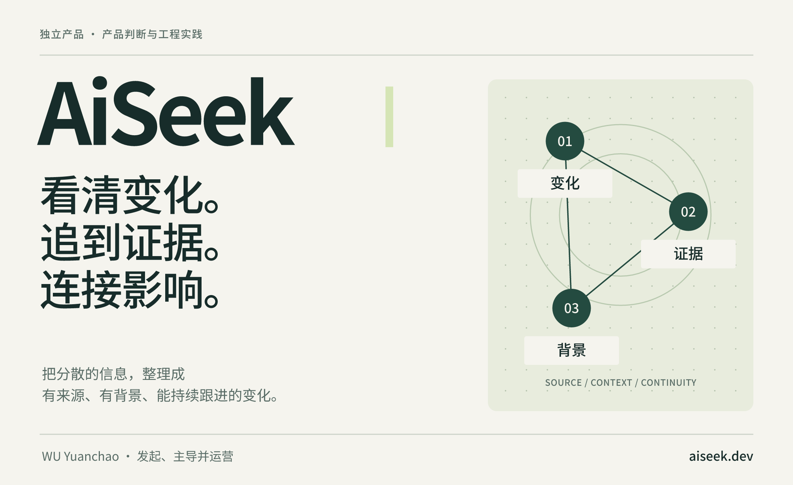
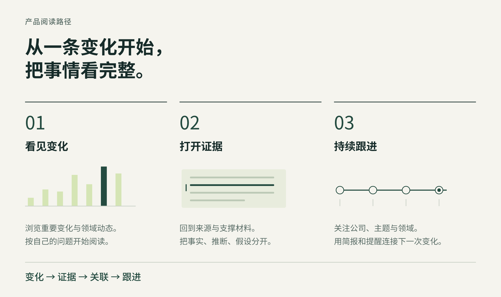
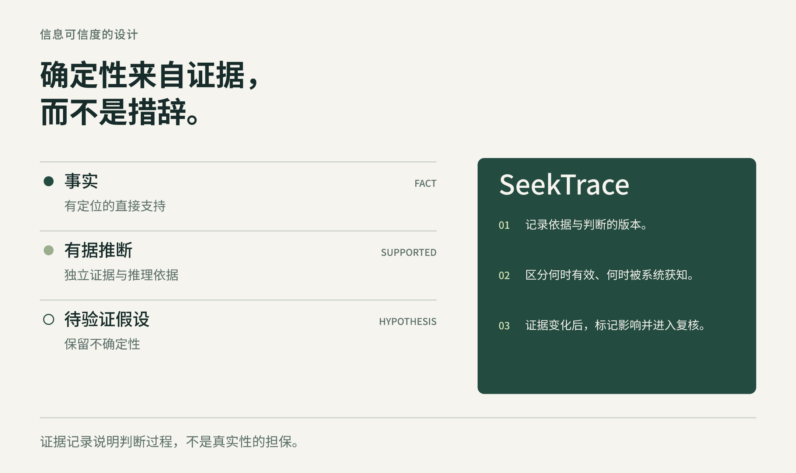
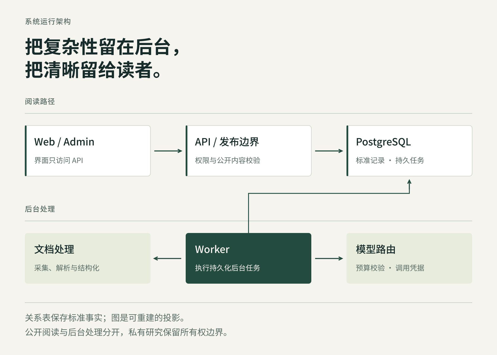
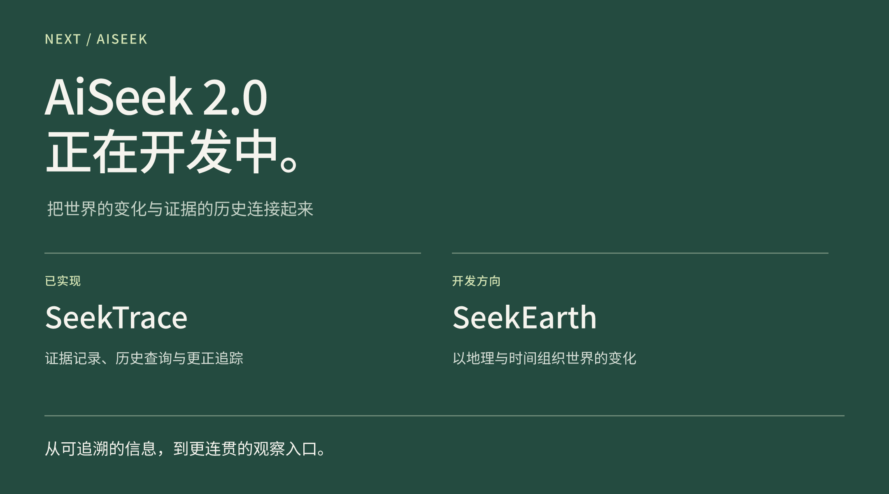

**简体中文** · [日本語](README.ja.md) · [English](README.md)

**真实运行的产品 · 中英日三语 · 只读 API 与 MCP**

  

**代码质量 · CodeScene 动态指标**

  

# AiSeek｜把变化读懂，把证据留下。

一个帮助读者看清重要变化、理解背景、追溯证据并持续跟进的多语言信息平台。由 **WU Yuanchao 发起、主导并运营**。

## 从一条信息，到一个值得跟进的变化

一项政策调整、一份公司公告、一次行业变化，通常散落在不同语言与来源中。AiSeek 将变化、支撑材料、相关对象和后续观察连接起来，让读者能从“发生了什么”继续走到“为什么值得关注”。

打开主站，读一条变化并查看来源；进入公司或主题页，探索有类型、有证据的关联；关注感兴趣的对象，用简报、提醒和发布日历持续跟进。现有 SeekMap 提供地理观察入口，结构视图帮助理解公司与主题之间的关系。

[体验 AiSeek](https://aiseek.dev/zh) · [查看方法](https://aiseek.dev/zh/method)

## 让事实、推断与假设各归其位

“有来源”还不够。AiSeek 将来源定位、直接支持、独立证据与矛盾纳入判断。**事实、得到支持的推断、待验证假设**分别呈现，模型的自信程度不能决定一条主张的类别。

**SeekTrace 已实现证据记录、历史查询与更正追踪。** 它记录判断依据，区分“何时有效”和“系统何时知道”，并在证据变化时标记受影响的内容、送入复核。完整性校验用于检查记录是否一致，不代表对结论真实性作担保。可回溯范围以实际保留的历史与账户权益为限。

[方法与证据](https://aiseek.dev/zh/method) · [公开更正](https://aiseek.dev/zh/corrections)

## 产品体验背后的工程判断

我将系统组织为职责清晰、可以核验的边界：界面只访问 API，公开阅读经过发布边界，长任务进入持久队列，模型调用先检查预算并留下凭据。共享数据契约连接各层，避免让不同模块各自解释同一个对象。

**把标准数据与图投影分开。** PostgreSQL 关系表保存标准记录，Apache AGE 承担可重建的图投影；队列与工作流状态复用 PostgreSQL，控制基础设施复杂度。

**让多语言贯穿检索。** 中文与日文检索使用 PGroonga，英文保留词形处理。别名和文字变体帮助找到同一个对象，有意义的型号差异则保留。登录用户主动发起的语义搜索在 API 中处理，通过模型路由管理调用。

**把可信度落实在边界。** 来源抓取权限与公开展示权限独立处理，私有研究有所有权与服务端权益校验。证据更正触发影响追踪，历史不足时保留未知，不用今天的状态补写过去。

**把上线作为交付的一部分。** 发布检查、可回退的应用版本、前向数据库迁移与恢复演练共同支撑持续运行。测试覆盖架构边界、证据规则、多语言身份和历史查询；它们验证规则，真实产品表现继续通过运行与更正记录检验。

**技术组合：** TypeScript · React Router · Fastify · Python · PostgreSQL · pgvector · PGroonga · Apache AGE · pg-boss。

## 让自己的工具读懂这些变化

只读 API 与 MCP 将已公开的变化、来源链接、公司背景、发布日历和证据历史提供给外部工具。每次工具调用使用个人密钥，接受服务端权限和额度校验；结果保留来源，私有研究不会进入公开输出。

[开发者说明](https://aiseek.dev/zh/developers) · [Glama](https://glama.ai/mcp/connectors/dev.aiseek/ai-seek) · [Smithery](https://smithery.ai/servers/wyc610721/aiseek)

## 我如何把它做成一个产品

我负责产品定位、使用路径、技术取舍、任务组织、验收与发布，也持续处理线上问题、证据更正和迭代方向。一个贯穿始终的判断是：读者首先需要看清变化和依据，Research 为这一体验提供支撑，并作为进一步探索的工具。

从信息筛选、多语言检索，到证据连续性与开发者接入，我把复杂需求拆成能交付、能检查的环节。AI 编程工具参与实现；方向、约束、审阅和交付决策由我负责。

## 下一阶段

**AiSeek 2.0 正在开发中。** SeekTrace 的证据基础已实现；接下来围绕 SeekEarth，把地点、时间、变化与关联组织成更连贯的观察入口。SeekEarth 及进一步的投资者观察能力属于开发方向，不作为当前已上线功能展示。

## 与我联系

欢迎交流产品与工程岗位、产品集成、分发合作，以及对独立开发的支持。

[LinkedIn](https://www.linkedin.com/in/yolow92/) · [GitHub](https://github.com/YOLOW92) · [邮件](mailto:support@aiseek.dev) · [支持 AiSeek](https://aiseek.dev/zh/sponsor)

图示为产品流程与架构说明。CodeScene 与运行状态以顶部动态徽章为准。[更新记录](https://aiseek.dev/zh/changelog) · [开源鸣谢](https://aiseek.dev/zh/credits)
