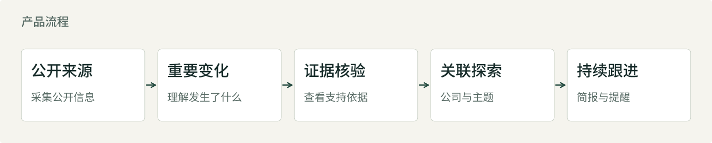
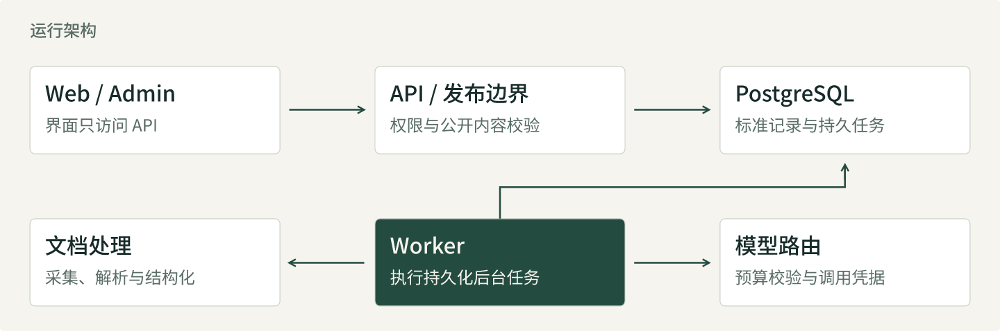

# AiSeek

[English](README.md) · **简体中文** · [日本語](README.ja.md)

追踪科技、经济、政策与公司的重要变化，连接来源、背景和后续跟进。

[体验产品](https://aiseek.dev/zh) · [开发者说明](https://aiseek.dev/zh/developers) · [方法说明](https://aiseek.dev/zh/method) · [更新记录](https://aiseek.dev/zh/changelog)

<a href="https://www.producthunt.com/products/aiseek?embed=true&amp;utm_source=badge-featured&amp;utm_medium=badge&amp;utm_campaign=badge-aiseek" target="_blank" rel="noopener noreferrer"></a>

**真实运行的产品 · 中英日三语 · 只读 API 与 MCP**

[](https://glama.ai/mcp/connectors/dev.aiseek/ai-seek) [](https://smithery.ai/servers/wyc610721/aiseek) [](https://incidents.betterstack.com/?utm_source=status_badge)

**代码质量 · CodeScene 动态指标**

[](https://codescene.io/projects/86173) [](https://codescene.io/projects/86173) [](https://codescene.io/projects/86173)

## 产品能力

- **理解变化。** 看清发生了什么、为什么重要，以及涉及哪些公司或主题。
- **追溯证据。** 查看支持来源，区分事实、有据推断和待验证假设。SeekTrace 记录判断依据、历史状态与更正。
- **探索关联。** 通过结构视图理解公司和主题之间的关系，利用现有 SeekMap 获得地理背景。
- **持续跟进。** 通过关注列表、提醒、每日与每周简报、发布日历，追踪关心的对象。



## 工程亮点



- **职责边界清楚：** 界面只访问 API，各层共用数据契约；公开读取经过发布边界，私有研究执行所有权校验。
- **数据可持久、图可重建：** PostgreSQL 保存标准记录，Apache AGE 作为可重建图投影；队列和工作流状态也复用 PostgreSQL。
- **证据规则落地：** 主张类别由证据决定，不由模型自信程度决定；更正标记受影响内容并进入复核，缺失历史保留未知。
- **执行与成本受控：** 长任务后台执行，付费模型请求经过预算与调用凭据；中日文检索使用 PGroonga，英文保留词形处理。

**技术栈：** TypeScript · React Router · Fastify · Python · PostgreSQL · pgvector · PGroonga · Apache AGE · pg-boss。

## 实现与验证

以下选自真实实现与测试，省略外围导入和测试准备代码。

**类型安全的 API 边界**

输入经过运行时 Schema 校验后获得 TypeScript 推导类型，失败则进入统一 API 错误处理。

```typescript
export function parse<T extends z.ZodTypeAny>(
  schema: T, input: unknown
): z.infer<T> {
  const r = schema.safeParse(input);
  if (!r.success) throw new AppError(
    "BAD_REQUEST",
    r.error.issues
      .map((i) => `${i.path.join(".")}: ${i.message}`)
      .join("; ")
  );
  return r.data;
}
```

**有界的网络读取**

响应超过字节预算时立即取消读取，避免先缓存整个响应再判断大小。

```typescript
for (;;) {
  const { done, value } = await reader.read();
  if (done) break;
  total += value.byteLength;
  if (total > maxBytes) {
    await reader.cancel();
    throw new SsrfError(`Response exceeds ${maxBytes} bytes`);
  }
  chunks.push(value);
}
```

**多语言回归覆盖**

用测试保证中文繁简体与日文汉字变体仍能对应同一个实体。

```typescript
it("folds traditional Chinese and Japanese kanji to simplified", () => {
  expect(nameKey("日本銀行")).toBe(nameKey("日本银行"));
  expect(nameKey("臺積電")).toBe(nameKey("台积电"));
  expect(nameKey("経済産業省")).toBe(nameKey("经济产业省"));
  expect(nameKey("台風27号")).toBe(nameKey("台风27号"));
});
```

## API 与 MCP

通过只读接口访问已公开的变化、来源链接、公司、发布日历与证据历史。工具调用使用个人密钥，服务端校验权限和额度；私有研究不会进入公开输出。

[开发者说明](https://aiseek.dev/zh/developers) · [Glama](https://glama.ai/mcp/connectors/dev.aiseek/ai-seek) · [Smithery](https://smithery.ai/servers/wyc610721/aiseek)

## 开发进展

**AiSeek 2.0 正在开发中。** SeekTrace 的证据记录与历史查询已实现。下一阶段围绕 SeekEarth，以地点与时间组织世界的变化；SeekEarth 不作为当前已上线功能展示。

## 开发者 WU Yuanchao

我发起、主导并运营 AiSeek，负责产品方向、技术决策、验收与发布。精选代码片段用于公开审阅，完整应用源码保持私有。

[LinkedIn](https://www.linkedin.com/in/yolow92/) · [GitHub](https://github.com/YOLOW92) · [邮件](mailto:support@aiseek.dev) · [支持 AiSeek](https://aiseek.dev/zh/sponsor)

<sub>[公开更正](https://aiseek.dev/zh/corrections) · [开源鸣谢](https://aiseek.dev/zh/credits)</sub>
