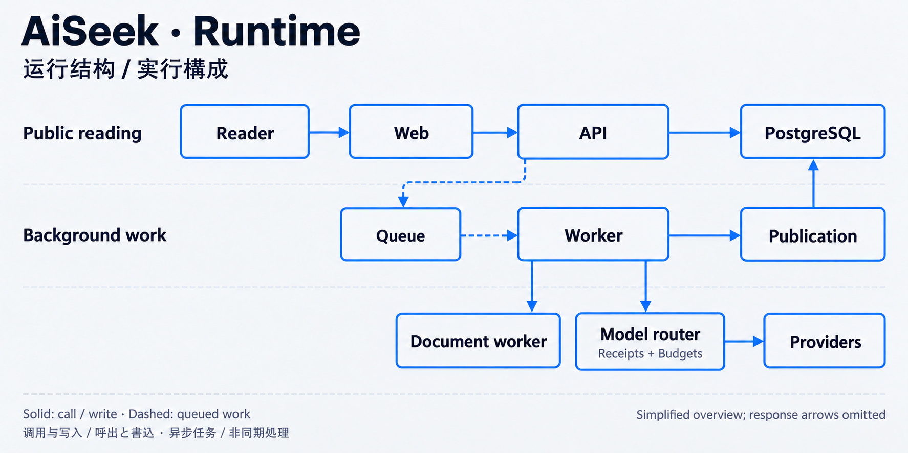

# Framework and runtime

[Portfolio](../README.md) · [中文](ARCHITECTURE.zh-CN.md) · [日本語](ARCHITECTURE.ja.md)

These diagrams show high-level responsibilities, checked against the reviewed source revision. They omit detailed product mechanisms, deployments and operating configuration. They are generated technical illustrations, not product screenshots.

## Framework / dependency direction

| Layer | Responsibility |
|---|---|
| Applications | Web and Admin present API data; API handles requests; Worker runs background jobs. |
| Workflows | Research, watches and publication coordinate longer work and public output. |
| Engines | Source, entity, evidence, graph and finance modules handle their respective domains. |
| Data access | Repositories and the PostgreSQL-backed queue provide controlled access to stored state. |
| Shared contracts | Types and schemas define boundaries between modules. |

The arrows describe permitted dependency direction, not a requirement that every call pass through every layer. Shared contracts also serve higher layers. Grouping applications does not permit every app to depend on every backend module: Web and Admin remain API-facing. The diagram groups adjacent engine layers for readability. The [architecture excerpt](../proof/code/frontend-boundary.test.ts) illustrates one enforced frontend boundary.

## Runtime / reading and background work

**Public reading:** Web requests published data through the API. It does not open a database connection or call a model provider. The displayed API-to-PostgreSQL line abbreviates the repository layer.

**Background work:** the API queues long operations; Worker executes them. Publication controls what becomes publicly readable. Document worker handles document processing. Model-router controls model calls through receipts and budgets. The diagram shows this selected route and omits other jobs, internal database access and return arrows.

**Stored state:** PostgreSQL relational records are canonical. The graph projection is rebuildable. Queue is a logical component backed by PostgreSQL, not an additional queue service. API and Worker are distinct runtime responsibilities within the same product.

Solid arrows show selected calls or writes; dashed arrows show queued work. These are responsibility diagrams, not a complete network topology or a promise of every security property. See the [evidence notes](../proof/README.md) for the scope of the checks.

## Stack, by responsibility

| Responsibility | Technology used in the main product |
|---|---|
| Web and Admin | TypeScript, React, React Router |
| API and Worker | TypeScript, Fastify, pg-boss |
| Canonical data and retrieval | PostgreSQL, pgvector, PGroonga |
| Graph projection | Apache AGE |
| Document processing | Python, FastAPI, document-processing libraries |

This is a framework overview, not a list of all dependencies. [Product credits](https://aiseek.dev/en/credits) retain upstream attribution. Reviewed **2026-10-15**.
