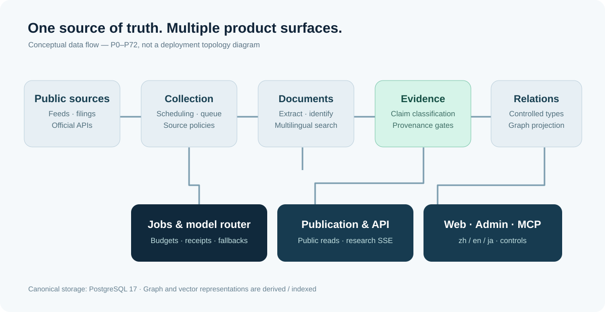

# 工程设计：技术选择与约束

[← 展示首页](../../README.zh-CN.md) · [English](README.md) · [日本語](README.ja.md) · [五个技术案例](CASES.zh-CN.md)

AiSeek P0–P72 是正在生产环境运行过的产品，并非完整开源安装包。业务源代码保持私有。下图代表**游戏开发前阶段的简化结构**，不代表 AiSeek 2.0 的部署现状。

> 这是原创系统说明图，**不是网页截图，也不是第三方审计报告**。

## 核心技术边界

| 层次 | 阶段性方案 | 强制约束 |
|:--|:--|:--|
| 网页 | React 19、React Router SSR、Tailwind、TypeScript、Motion | 页面渲染不直接调大模型，也不直接连数据库 |
| API | Node 24、Fastify、Zod | 权限与订阅权益由服务端检查 |
| 队列与研究 | pg-boss、LangGraph.js、SSE | 长任务与请求渲染隔离 |
| 文档处理 | Python、FastAPI、Crawl4AI、Docling 等 | 采集许可与提取处理分离 |
| 权威数据 | PostgreSQL 17、pgvector、PGroonga、Apache AGE 图投影 | 关系表为正本，图投影可重建 |
| 交付运维 | Docker Compose、VPS CI、反向代理、备份恢复 | 密钥、部署、迁移受工程规则约束 |

这是一套刻意保持分层的系统，不是为了展示微服务数量而拆分。技术依赖在阶段中不断更新，不应再把 10 月 6 日的旧版本列表当成 P72 的最终清单。

## 五项值得展开的工程决策

**1 · 证据分级由规则决定。** 公开论断区分 FACT、SUPPORTED、HYPOTHESIS，模型自信程度不能直接决定标签。[真实代码：证据决策](../../proof/code/promote.ts)。

**2 · 关系类型受约束。** 注册表限制关系两端的对象类别、逆关系、有效时间及衰减周期，模型不能随意创造新关系。[真实代码：关系注册表](../../proof/code/relation-registry.ts)。

**3 · 多语言搜索不能只靠翻译。** P59 引入 PGroonga 处理中日文全文检索，跨文字体系的实体名称另做归一化，英文保留独立的检索处理。

**4 · 信息量不等于趋势。** 完整自然日、历史基线与信源变化检测用于降低误判；更复杂的趋势模型仍需长期数据验证。

**5 · 资源有限也要保障系统稳定。** 统一模型路由管理预算和降级，单机计算队列设置等待上限，避免积压没有价值的请求。[真实代码：准入闸门](../../proof/code/gate.py)。

## 安全、运维与限制

- **允许采集**与**允许对外发布**是两套独立的合规判断。
- 私有研究使用身份验证、明确所有权校验，适用数据另有行级保护。
- 架构测试约束分层和模型调用入口。
- 数据库迁移只追加，部署和恢复按既定流程执行。
- P72 增加浏览器错误报告；同期曾加入的发布前浏览器冒烟测试**后来按项目决策删除**，不能算现有能力。
- 证据和引用机制可以降低部分错误，但不保证结果绝对真实；准确率必须结合具体样本说明。

继续阅读：[工程案例](CASES.zh-CN.md) · [证据与限制](../proof/README.zh-CN.md) · [产品介绍](../product/README.zh-CN.md)
