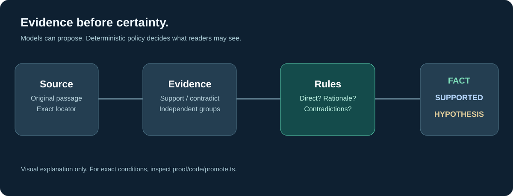

# Product / 产品 / 製品

[← Portfolio](../../README.md) · [中文](README.zh-CN.md) · [日本語](README.ja.md)

## What AiSeek is

AiSeek is an independently built, production-operated **change-intelligence platform**. It collects permitted public information across 24 subject areas and organizes changes into a chain a reader can examine: **signal → evidence → entities → relationships → implications**.

It aims to answer a different question from a conventional news feed: *What actually changed, how does it connect to other things, and where did that assertion come from?*

> This graphic is an original explanatory illustration, not a screenshot or a representation of a specific research result.

### A reader's path

1. **Discover a change.** Read a curated signal, daily brief, story or topic.
2. **Inspect its provenance.** Go from a claim to supporting passages, primary sources where available and any correction.
3. **Explore its context.** Follow a company's public relationships, a chain between entities, or SeekMap's geographic view.
4. **Keep track.** Follow subjects, review changes since the last visit, use calendars, alerts or a weekly summary.
5. **Integrate.** Read public information through a documented read API or an MCP-compatible interface, subject to plan entitlements.

### Five product surfaces, as of the P72 boundary

| Surface | Delivered capability | Why it matters |
|:--|:--|:--|
| **Discover & Stories** | Signals, daily brief, evidence-linked deep reads, source and correction affordances | Less browsing without losing traceability |
| **Structure** | Evidence-backed entity relationships, controlled relation types, company positions and bounded paths | Shows relationships beyond headlines |
| **SeekMap** | Country-oriented changes, filters, historical baseline and separately attributed public observation layers | Geographic context with fewer misleading heat readings |
| **Research & Ask** | Guided research with streaming progress; citation checks including Chinese/Japanese paths | Assists exploration while exposing uncertainty |
| **Personal & Developer** | Following, calendar, alerts, installable web app, API, MCP, embeds and subscriptions | Makes the information reusable |

The public website supports **Chinese, English and Japanese**. Translations are prepared upstream rather than generated in the render path. The system is not a guarantee that every article, model output or relationship is correct.

### Example use case (illustrative, not a computed output)

Suppose an official document reports a change in semiconductor-related trade restrictions. Instead of only displaying the headline, a reader should be able to inspect the original disclosure, distinguish the documented policy action from inferred downstream impacts, explore affected organizations and technologies, and track future official updates. This describes the intended workflow, **not an assertion about any named company**.

### Explore the real product

- [English website](https://aiseek.dev/en)
- [SeekMap](https://aiseek.dev/en/seekmap/jp)
- [Methodology](https://aiseek.dev/en/method)
- [Developer interfaces](https://aiseek.dev/en/developers)

**Scope note:** this showcase freezes the **P0–P72, pre-game** product stage (October 2026). The live site may have moved on. Game features and AiSeek 2.0 are intentionally excluded.

Next: [Engineering](../engineering/README.md) · [Product journey](../journey/README.md) · [Evidence register](../proof/README.md)
