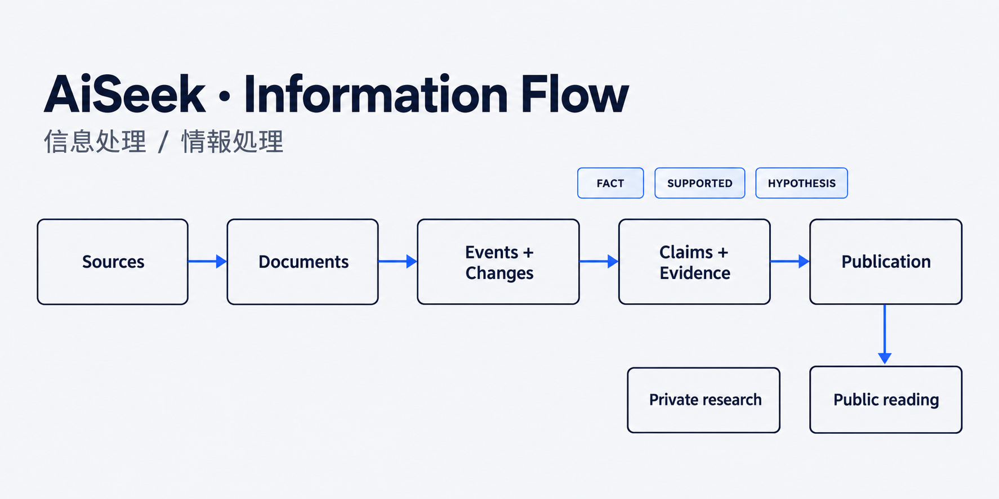

# 01 / 主張に根拠の境界を設ける

[ポートフォリオ](../README.ja.md) · [English](evidence-engine.md) · [简体中文](evidence-engine.zh-CN.md) · [日本語](evidence-engine.ja.md)

**ルール設計 · データモデル · 品質判断**

## 課題

自然な文章でも根拠がないことがあります。文章を作る経路が同時に事実と認定すると、読者は直接の報告と推論を区別しにくくなります。

## 私の判断

根拠に基づく分類と、支える箇所をたどれることを要件としました。分類は決定的なシステムの責任とし、モデルの自信を事実認定の権限にしません。

## 実装

主張、根拠、関係を別の記録として扱い、正規の関係は主張を参照します。公開出力では FACT、SUPPORTED、HYPOTHESIS を区別し、訂正の過程で公開済みの内容を再確認できます。

## 結果と根拠

選定したテストでは、原文の位置を持たない直接の主張を HYPOTHESIS のまま扱います。製品の方法説明と訂正ページで挙動を確認できます。

[evidence-locator.test.ts](../proof/code-excerpts/evidence-locator.test.ts) · [method](https://aiseek.dev/ja/method) · [corrections](https://aiseek.dev/ja/corrections)

## 次の作業

ラベル付き評価の基準は採点が残っています。次は確認済みの標本で根拠の品質を測ることです。

[技術事例の一覧](README.ja.md)
