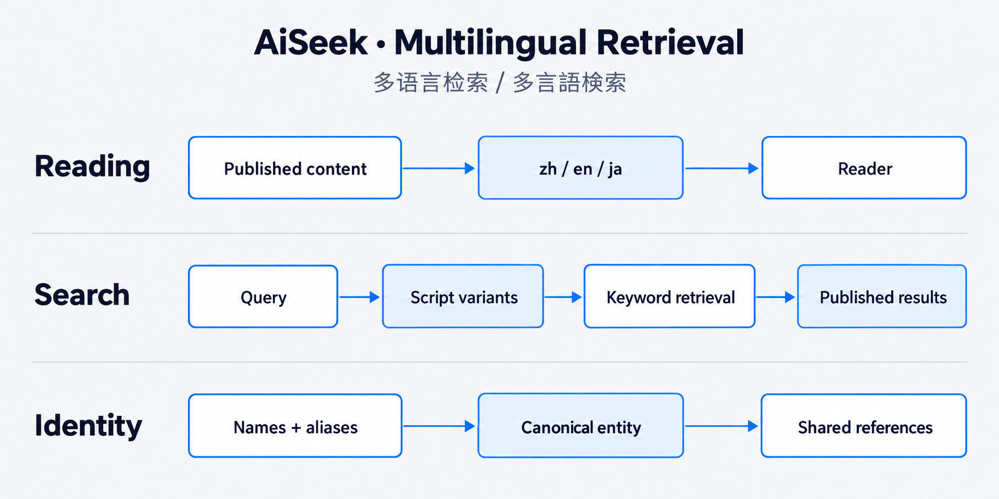

# 03 / Search across scripts without merging the wrong things

[Portfolio](../README.md) · [English](multilingual-search.md) · [简体中文](multilingual-search.zh-CN.md) · [日本語](multilingual-search.ja.md)

**Multilingual retrieval · Data engineering · Selection of tools**

## Problem

Translating interface labels does not make a Chinese or Japanese query work. Script variants split familiar names, while aggressive normalisation can merge different model numbers.

## My judgment

I separated reading language, retrieval and entity identity. Chinese and Japanese need suitable indexing; identity also needs guards that preserve meaningful differences.

## Implementation

PGroonga supports CJK retrieval; English keeps its stemming path. Script variants and aliases support lookup, while stable entity references connect content across languages. Model-number checks protect distinct products.

## Results and evidence

The selected tests cover 日本銀行/日本银行 and 臺積電/台积电, and distinguish NVIDIA B200 from H200. Integration fixtures check published search results across languages and exclude unpublished material.

[script-identity.test.ts](../proof/code-excerpts/script-identity.test.ts) · [model-identity.test.ts](../proof/code-excerpts/model-identity.test.ts)

## Next step

A broader relevance baseline and data-dependent identity follow-ups remain to be measured.

[All engineering cases](README.md)
