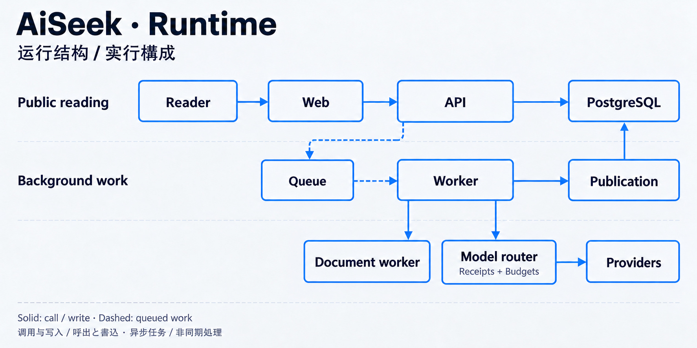

# 04 / 把长任务移出请求路径

[作品集](../README.zh-CN.md) · [English](production-architecture.md) · [简体中文](production-architecture.zh-CN.md) · [日本語](production-architecture.ja.md)

**队列 · 成本意识 · 容错 · 运行架构**

## 问题

独立产品的运维能力有限。让页面等待采集或研究，会把阅读延迟绑到耗时且容易失败的工作上；每遇到问题就加服务，也会增加负担。

## 我的判断

我用 PostgreSQL 保存标准记录并承载队列，分开 API 与 Worker 的职责，以调用凭据和预算约束外部请求。前端只读 API。

## 通用实现

长任务入队后在后台执行，文档处理有独立服务边界。图是关系记录的可重建投影，而不是第二份标准事实源。

## 结果与证据

所选架构测试拒绝 API 源码同步执行研究。运行结构分开公开阅读、队列任务和受控外部调用。

[async-boundary.test.ts](../proof/code-excerpts/async-boundary.test.ts) · [status](https://status.aiseek.dev)

## 下一步

代价是协调：重试、权限、预算和任务契约必须保持一致。功能增长时，简洁的运维仍然依赖纪律。

[全部工程案例](README.zh-CN.md)
