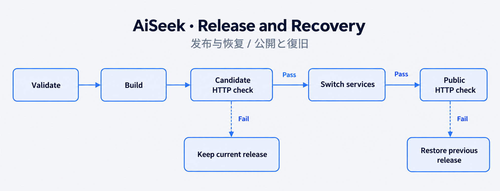

# 05 / 把发布失败当作正常情况设计

[作品集](../README.zh-CN.md) · [English](production-engineering.md) · [简体中文](production-engineering.zh-CN.md) · [日本語](production-engineering.ja.md)

**权限控制 · CI/CD · 恢复 · 生产排错**

## 问题

构建通过不代表候选版本就能接管流量，恢复路径也可能失败：曾有镜像标签缺失，导致回退找不到此前运行的文档处理镜像。

## 我的判断

我要求激活前验证、切换前后检查，并保留上一版本。权限与发布边界也是交付的一部分，不留给前端自行判断。

## 通用实现

发布链路完成验证、构建、候选 HTTP 检查、服务切换与公网检查。切换前失败保留当前版本，切换后失败进入恢复；测试还要求非法发布命令在接触生产前被拒绝。

## 结果与证据

所选命令测试覆盖拒绝输入。源码回归套件模拟候选失败、切换后失败、恢复此前版本，并覆盖正在运行镜像的引用保留。

[release-command.test.sh](../proof/code-excerpts/release-command.test.sh) · [changelog](https://aiseek.dev/zh/changelog)

## 下一步

浏览器错误收集已交付。当前发布路径使用 HTTP 检查，发布前浏览器检查已删除；数据库修复使用向前迁移。

[全部工程案例](README.zh-CN.md)
