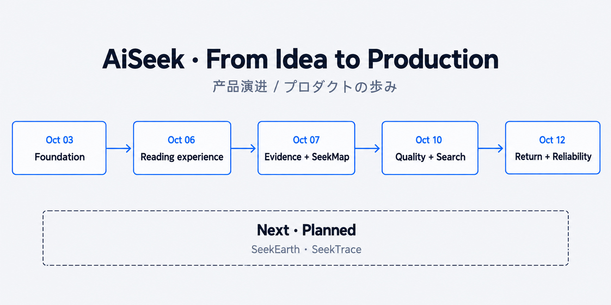

# Founder / AiSeek を形にするまで

[ポートフォリオ](../README.ja.md) · [English](journey.md) · [简体中文](journey.zh-CN.md) · [日本語](journey.ja.md)

## 私の役割

AiSeek を立ち上げ、製品の方向性から運用まで担当しています。曖昧なアイデアを要件にし、技術の選択を行い、結果を確認し、公開後も修正する過程を示すプロジェクトです。

| 責任 | 私の担当 |
|---|---|
| 製品 | ユーザーの課題、位置づけ、読書の流れ、優先順位 |
| 技術の方向 | システムの境界、品質ルール、資源の制約 |
| 提供 | 作業の分解、レビュー、受け入れ、公開判断 |
| 運用 | 訂正、本番の問題、改善、事業の方向 |

## アイデアから実運用へ

| 節目 | 重要な判断 |
|---|---|
| 10 月 3 日 · 基盤 | 共通の契約を設け、動作と確認ができるアプリケーションにする。 |
| 10 月 6 日 · 読書体験 | 製品の分かりやすさ、モバイル配置、言語を読書の流れに組み込む。 |
| 10 月 7 日 · 根拠と SeekMap | 支える資料を見える形にし、変化に地理的背景を与える。 |
| 10 月 10 日 · 品質と検索 | 誤解を生む基準値を修正し、表記をまたぐ検索に対応する。 |
| 10 月 12 日 · 再訪と信頼性 | 再訪経路、測定の基盤、ブラウザーのエラー報告を加える。 |
| 次の段階 · 計画 | SeekEarth で明確な中心を作り、SeekTrace で根拠の継続性を強める。 |

研究を優先した入口から、重要な変化を読む情報製品へ方向も変わりました。Research は支える機能と深い調査の道具として残しています。

## 開発方法

AI コーディングツールが実装に参加しています。方向と制約を定め、作業を組織し、結果をレビューして受け入れを判断するのは私です。

[技術判断](../engineering/README.ja.md) · [事業の方向](../business/opportunity.ja.md) · [連絡先](../connect/README.ja.md)
